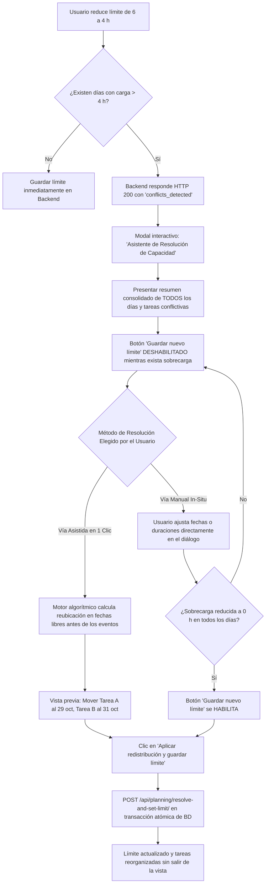
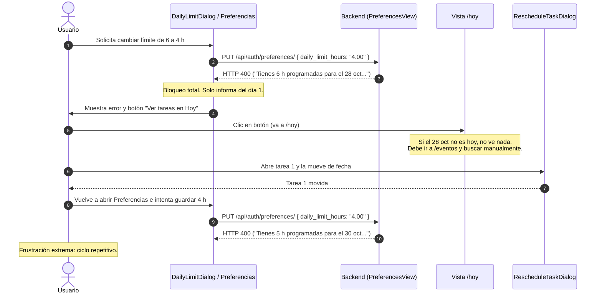
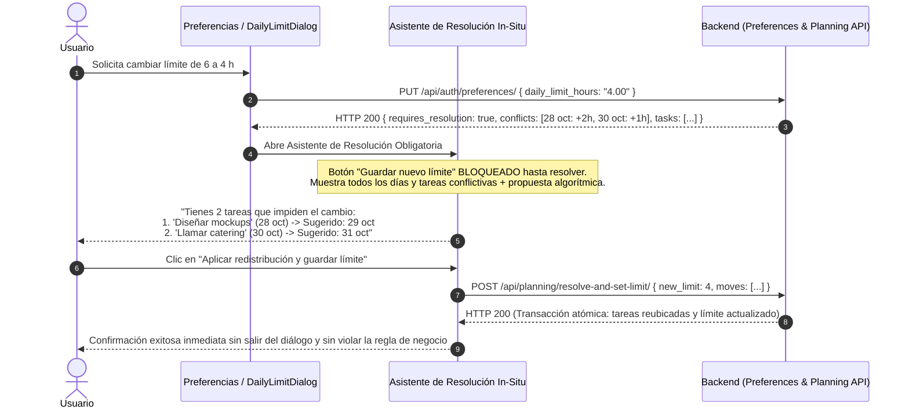

# Auditoría de Fricción Crítica, Restricciones Operativas y Flujos UX
**Aplicación:** Eventger Frontend & Backend<br>
**Fecha de Auditoría:** 26 de Octubre de 2026<br>
**Auditor:** Senior UX Researcher, Product Designer, Interaction Designer & HCI Specialist<br>
**Metodología:** Evaluación Heurística (Nielsen-Molich), Análisis de Carga Cognitiva (Sweller), Mapeo de Flujos de Tarea (Task Flow Analysis) y Auditoría Estática de Lógica de Negocio<br>
**Estado:** Concluida — Sin Modificaciones de Código en esta Fase<br>

---

## 1. Resumen Ejecutivo

La presente auditoría evalúa la experiencia de usuario de **Eventger** desde la perspectiva de la interacción humana, la carga operativa y la economía cognitiva del usuario.

El sistema se encuentra técnicamente sólido: las validaciones de base de datos son estrictas, la integridad referencial se preserva y la interfaz visual es armónica. No obstante, **el diseño de interacción traslada al usuario la carga de resolver manualmente la complejidad interna de las reglas de negocio**.

### Hallazgos Principales
1. **Bloqueo por dependencias en cascada (Anti-patrón "Whack-a-Mole"):** Al intentar reducir el límite diario de trabajo (`daily_limit_hours`) o al adelantar la fecha de un evento, el sistema bloquea la operación principal con un error 400 y obliga al usuario a navegar fuera de contexto, localizar individualmente las tareas en conflicto, reprogramarlas una a una en diálogos modales independientes y luego reintentar la acción original.
2. **Falta de visibilidad del conflicto:** Cuando una validación falla por sobrecarga de horas, el sistema únicamente reporta el primer día con mayor carga (`.first()`), ocultando si existen 2, 5 o 10 días adicionales en conflicto. El usuario debe iterar a ciegas en un ciclo repetitivo de prueba y error.
3. **Rigidez en la unidad atómica de capacidad:** Las tareas en estado `in_progress` (en progreso) retienen el 100% de sus horas estimadas originales en el cálculo de carga diaria, impidiendo registrar horas parciales ejecutadas. Esto genera "bloqueos ficticios" de capacidad en la agenda.
4. **Discrepancia cognitiva entre "Editar" y "Reprogramar":** Una tarea cuenta con dos puntos de entrada para modificar fechas y horas: `EditSubtaskDialog` y `RescheduleTaskDialog`. Si un usuario modifica la fecha en `EditSubtaskDialog` y produce sobrecarga, el diálogo falla con un error opaco y genérico sin explicar la causa, mientras que `RescheduleTaskDialog` cuenta con motor de sugerencias y resolución asistida.
5. **Falta de transaccionalidad compuesta en la creación:** En `CreateEventPage`, el evento se persiste en backend antes de enviar sus subtareas en un bucle secuencial no atómico. Si una tarea falla, se genera un evento huérfano con datos parciales.

---

## 2. Inventario de Flujos de Trabajo Revisados

| Flujo de Trabajo | Punto de Entrada | Objetivo Real del Usuario | Pasos Técnicos Actuales | Grado de Fricción |
| :--- | :--- | :--- | :--- | :---: |
| **F-01: Reducción de Capacidad Diaria** | `/configuracion` o modal en `/hoy` | Ajustar su disponibilidad de trabajo diaria a su realidad laboral. | Modificar número $\rightarrow$ Recibir error 400 $\rightarrow$ Salir $\rightarrow$ Buscar tareas del día $\rightarrow$ Reprogramar una a una $\rightarrow$ Regresar a guardar. | **CRÍTICA (Bloqueo)** |
| **F-02: Reprogramación de Fecha de Evento** | `/evento/:id` $\rightarrow$ Editar evento | Mover un evento hacia una fecha más próxima (adelantar el evento). | Cambiar fecha $\rightarrow$ Recibir error 400 con lista de 5 nombres $\rightarrow$ Cancelar edición $\rightarrow$ Buscar y mover tareas $\rightarrow$ Reintentar. | **CRÍTICA (Bloqueo)** |
| **F-03: Edición de Subtarea con Conflicto** | `/evento/:id` $\rightarrow$ Menú $\rightarrow$ Editar tarea | Cambiar la fecha o tiempo de una subtarea existente. | Modificar fecha/horas $\rightarrow$ Guardar $\rightarrow$ Error genérico opaco sin explicación de conflicto. | **ALTA (Falta de visibilidad)** |
| **F-04: Registro de Avance Parcial** | `/hoy` o `/evento/:id` $\rightarrow$ Registrar avance | Dejar constancia de horas trabajadas hoy y horas pendientes. | Abrir diálogo $\rightarrow$ Solo permite cambiar estado a `in_progress` $\rightarrow$ Las horas estimadas no se reducen $\rightarrow$ Capacidad bloqueada. | **MEDIA (Rigidez de modelo)** |
| **F-05: Creación de Evento con Tareas** | `/crear` | Planificar un evento integral con sus actividades iniciales. | Completar formulario y lista de tareas $\rightarrow$ Enviar $\rightarrow$ Creación secuencial no atómica $\rightarrow$ Riesgo de estado parcial. | **MEDIA (Riesgo transaccional)** |
| **F-06: Localización de Eventos a Escala** | `/eventos` | Encontrar un evento específico entre decenas de registros. | Navegar página por página (paginación lineal sin búsqueda ni ordenación por fecha/estado). | **MEDIA (Escalabilidad)** |

---

## 3. Problemas Críticos Confirmados

### CRIT-01: Bloqueo Estricto y Ocultamiento de Conflictos en Reducción de Capacidad Diaria
- **Flujo:** F-01 (Configuración de Preferencias / Modal Límite Diario en Hoy).
- **Objetivo del usuario:** Disminuir sus horas diarias disponibles (ej. de 6.00 h a 4.00 h) para reflejar menor disponibilidad.
- **Comportamiento actual:** El backend ejecuta `validate_daily_limit_reduction` (`apps/subtasks/planning.py`). Si la suma de tareas pendientes en cualquier día supera el nuevo límite, rechaza con HTTP 400 devolviendo únicamente el día con mayor sobrecarga (`.order_by("-total", "day").first()`). El frontend muestra un modal con el mensaje y un botón "Ver tareas en Hoy" que redirige a `/hoy`.
- **Bloqueo o fricción:**
  1. Si el día conflictivo es futuro (o pasado con tareas vencidas), en `/hoy` no se visualizan las tareas de esa fecha. El usuario no sabe qué tareas causan el problema ni en qué eventos están.
  2. Si existen 4 días con sobrecarga, el usuario debe arreglar el día 1 a ciegas, volver a intentar guardar, recibir el error del día 2, arreglarlo, y así sucesivamente.
  3. No existe reprogramación en lote: cada tarea debe editarse en un modal propio.
- **Causa raíz:** Regla de negocio ("ningún día puede superar `daily_limit_hours`") acoplada de forma sincrónica e inflexible a la actualización de la preferencia del usuario, sin distinguir entre una regla de planificación y un bloqueo administrativo.
- **Evidencia:** [backend/apps/subtasks/planning.py#L20-L36](https://github.com/Eventger/backend/blob/main/apps/subtasks/planning.py#L20-L36) y [frontend/frontend/src/features/today/components/DailyLimitDialog.tsx#L105-L118](../src/features/today/components/DailyLimitDialog.tsx#L105-L118).
- **Impacto:** Abandono del flujo; imposibilidad de ajustar la jornada laboral; frustración severa.
- **Severidad:** **Crítica**
- **Restricciones que deben mantenerse:** El cálculo algorítmico de sobrecarga y la prevención de sobrecargas involuntarias durante la reprogramación de tareas individuales.
- **Alternativas evaluadas:** Reprogramación asistida (A), Reprogramación automática (B), Reprogramación masiva (C), Tolerancia a sobrecarga con advertencia (D), Enfoque Híbrido Asistido (E).
- **Solución recomendada:** Implementar la **Alternativa E (Estrategia Híbrida)**:
  1. El backend permite actualizar la preferencia de capacidad y devuelve en la respuesta el listado de todos los días y tareas que quedan en sobrecarga (`conflicts: [...]`).
  2. En el frontend, el diálogo de confirmación muestra un resumen claro de los días afectados y ofrece dos caminos:
     - *Opción Inmediata:* Guardar con advertencias (el sistema marca las tareas sobrecargadas en Hoy con insignias de atención).
     - *Opción Asistida:* Asistente paso a paso que sugiere automáticamente días libres para redistribuir las tareas excedentes con un solo clic.
- **Criterios de aceptación:**
  1. El usuario puede cambiar su límite diario sin ser bloqueado de antemano.
  2. Todos los días en conflicto se presentan simultáneamente en una sola vista explicativa.
  3. Las tareas afectadas pueden reubicarse sin tener que navegar por múltiples pantallas.
- **Pruebas necesarias:** Simular usuario con 5 eventos y 3 días que superan el nuevo límite; verificar que se liste la totalidad de los conflictos y que la reubicación asistida preserve las fechas límite de los eventos padres.

---

### CRIT-02: Bloqueo en Adelanto de Fecha de Evento por Subtareas Posteriores
- **Flujo:** F-02 (Edición de Evento en `/evento/:id`).
- **Objetivo del usuario:** Modificar la fecha de un evento para realizarlo antes de lo previsto (ej. adelantar del 25 al 10 de noviembre).
- **Comportamiento actual:** `EventSerializer.update` (`apps/events/serializers.py`) ejecuta:
  ```python
  outside = current.subtasks.exclude(
      state__in=[Subtask.State.POSTPONED, Subtask.State.COMPLETED]
  ).filter(target_date__date__gt=deadline).order_by("target_date", "pk")
  names = list(outside.values_list("name", flat=True)[:5])
  if names:
      raise serializers.ValidationError({"date": [
          "La fecha del evento no puede ser anterior a la fecha límite de sus tareas. "
          "Reprograma primero estas tareas: " + ", ".join(names) + "."
      ]})
  ```
- **Bloqueo o fricción:**
  1. La operación principal ("cambiar la fecha del evento") queda completamente abortada.
  2. El usuario pierde el foco del formulario y debe cancelar para ir a buscar las tareas mencionadas.
  3. Si hay más de 5 tareas (`[:5]`), solo se informan las primeras 5, generando un ciclo de corrección repetitivo.
- **Causa raíz:** Invariante de negocio válida (`subtask.target_date <= event.date`) gestionada como barrera de entrada en lugar de ofrecer ajuste automático en cascada.
- **Evidencia:** [backend/apps/events/serializers.py#L91-L102](https://github.com/Eventger/backend/blob/main/apps/events/serializers.py#L91-L102).
- **Impacto:** Alto. Obliga a $N$ operaciones de reprogramación manual antes de permitir una sola edición de evento.
- **Severidad:** **Alta**
- **Restricciones que deben mantenerse:** Ninguna subtarea puede tener fecha límite posterior a la realización del evento.
- **Alternativas evaluadas:**
  - *Rechazo estricto (actual):* Inviable a escala.
  - *Ajuste en cascada ciego:* Forzar todas las tareas al nuevo día del evento (puede sobrecargar ese día).
  - *Ajuste asistido con vista previa:* El diálogo de edición detecta las tareas fuera de rango y ofrece ajustar su fecha límite a la nueva fecha del evento (o fecha sugerida anterior con capacidad disponible) antes de confirmar.
- **Solución recomendada:** Al detectar tareas con `target_date > nueva_fecha_evento`, el modal de edición de evento debe mostrar una sección interactiva: *"Se ajustará la fecha límite de X tareas a la nueva fecha del evento (o fecha disponible previa)"* con desglose y confirmación en un solo paso.
- **Criterios de aceptación:**
  1. El usuario puede adelantar un evento en un único flujo de guardado.
  2. El sistema muestra la lista completa de tareas que serán reajustadas.
  3. Se calculan las cargas de los nuevos días asignados para evitar sobrecargas sorpresa.
- **Pruebas necesarias:** Crear evento con 8 tareas distribuidas a lo largo de un mes; cambiar la fecha al día 10; verificar que el modal ofrezca reasignación consolidada y aplique los cambios atómicamente.

---

### CRIT-03: Opacidad y Ruptura de Recuperación de Errores en `EditSubtaskDialog`
- **Flujo:** F-03 (Edición de Subtarea en Detalle de Evento).
- **Objetivo del usuario:** Cambiar la fecha o la duración estimada de una tarea desde el diálogo de edición general.
- **Comportamiento actual:** `EditSubtaskDialog` permite capturar `targetDate` y `estimatedHours`. Al presionar guardar, si la nueva fecha/hora supera la capacidad diaria del usuario, el backend lanza un `SchedulingConflict` (HTTP 409). Sin embargo, `EditSubtaskDialog.tsx:L219-L222` captura el error de forma genérica:
  ```tsx
  } catch {
    setSubmitError('No pudimos guardar los cambios de la tarea. Inténtalo de nuevo.')
  }
  ```
- **Bloqueo o fricción:**
  1. El usuario no recibe información sobre el motivo real del fallo (cree que es un error de conexión o del servidor).
  2. No se le indica que el día está sobrecargado ni cuántas horas exceden.
  3. Si el usuario utiliza la acción "Reprogramar" en lugar de "Editar", el sistema sí le muestra el diálogo con sugerencias (`RescheduleTaskDialog`). Existe una inconsistencia funcional severa entre dos botones de la misma tarjeta.
- **Causa raíz:** Desconexión entre el manejador de excepciones del cliente en `EditSubtaskDialog` y el contrato de errores de la API (`SchedulingConflict`).
- **Evidencia:** [frontend/frontend/src/features/events/components/detail/EditSubtaskDialog.tsx#L210-L226](../src/features/events/components/detail/EditSubtaskDialog.tsx#L210-L226) vs. [frontend/frontend/src/features/events/components/detail/RescheduleTaskDialog.tsx](../src/features/events/components/detail/RescheduleTaskDialog.tsx).
- **Impacto:** Alto esfuerzo cognitivo; reintentos fallidos sucesivos; confusión sobre la estabilidad de la plataforma.
- **Severidad:** **Media-Alta**
- **Restricciones que deben mantenerse:** Respetar la verificación de sobrecarga diaria al modificar horas o fechas.
- **Solución recomendada:** Unificar la lógica de reprogramación: si en `EditSubtaskDialog` se detecta un cambio de fecha o de horas estimadas, delegar la validación y resolución al motor de conflictos de `RescheduleTaskDialog` o mostrar el bloque de resolución de conflicto dentro del mismo modal.
- **Criterios de aceptación:**
  1. Si `EditSubtaskDialog` recibe un error de sobrecarga (409), debe mostrar el mensaje semántico de conflicto con desglose de horas.
  2. Debe ofrecer la opción de aceptar la fecha sugerida o ajustar horas directamente.
- **Pruebas necesarias:** Editar tarea asignando fecha con sobrecarga; verificar que se informe el conflicto explícitamente sin mensajes genéricos.

---

### CRIT-04: Carga Fantasma por Tareas "En Progreso" sin Registro Parcial de Horas
- **Flujo:** F-04 (Registro de Avance en `/hoy` y `/evento/:id`).
- **Objetivo del usuario:** Indicar que ha avanzado en una tarea de 6 horas habiendo completado 4 horas, restándole 2 horas de trabajo.
- **Comportamiento actual:** `RegisterProgressDialog` solo permite cambiar el estado (`pending`, `in_progress`, `completed`, `postponed`) y añadir una nota textual. Al seleccionar `in_progress`, el sistema mantiene íntegras las 6 horas estimadas en la agenda del día.
- **Bloqueo o fricción:**
  1. El usuario tiene una tarea casi terminada (le falta 1 hora), pero el sistema bloquea 6 horas completas en su límite diario.
  2. El dashboard de Hoy indica que el usuario está "Sobrecargado", cuando en realidad tiene capacidad real disponible.
  3. Para resolver esto manualmente, el usuario tiene que hacer malabares: editar la subtarea, cambiar `estimatedHours` a 1 h, y anotar en la descripción "originalmente eran 6 h".
- **Causa raíz:** El modelo de datos acopla la duración estimada total con la carga pendiente restante, sin soporte para `remaining_hours` o deducción por avance.
- **Evidencia:** [backend/apps/subtasks/services.py#L40-L73](https://github.com/Eventger/backend/blob/main/apps/subtasks/services.py#L40-L73) y [frontend/frontend/src/features/events/components/detail/RegisterProgressDialog.tsx#L111-L180](../src/features/events/components/detail/RegisterProgressDialog.tsx#L111-L180).
- **Impacto:** Distorsión de las métricas de carga diaria; alertas de sobrecarga falsas; necesidad de manipulación manual de datos.
- **Severidad:** **Media**
- **Restricciones que deben mantenerse:** Mantener el seguimiento del tiempo total planificado para el progreso del evento.
- **Solución recomendada:** En `RegisterProgressDialog`, al seleccionar `in_progress`, habilitar un campo opcional: *"Horas restantes"* o *"Tiempo dedicado hoy"*, permitiendo que la carga computada para el día sea únicamente el remanente real de trabajo.
- **Criterios de aceptación:**
  1. Las tareas en progreso reflejan su carga pendiente real en el resumen diario.
  2. No se activan falsas alarmas de sobrecarga por tareas parcialmente ejecutadas.
- **Pruebas necesarias:** Registrar avance en tarea de 6h indicando 2h restantes; comprobar que el resumen de Hoy sume 2h y no 6h.

---

## 4. Hipótesis de Usabilidad Pendientes de Validación

1. **H-01 (Comprensión de Badges de Estado):** Se hipotetiza que los usuarios noveles confunden el badge "Hoy" en tareas con la fecha del evento, creyendo que el evento ocurre hoy en lugar de ser la fecha límite de la subtarea. *Requiere prueba de usabilidad con 5 usuarios nuevos.*
2. **H-02 (Percepción del Menú de 3 Puntos vs. Botones Inline):** Tras la remoción del botón "Ver notas" en las tarjetas de tareas de Hoy, se hipotetiza que usuarios con baja alfabetización digital podrían tardar más en descubrir los detalles de una tarea al requerir la apertura del menú contextual. *Requiere telemetría de eventos de clic en el menú.*
3. **H-03 (Preferencia de Redistribución Automática):** Se hipotetiza que más del 70% de los usuarios preferiría que el sistema redistribuya automáticamente las tareas sobrecargadas al cambiar el límite diario, en lugar de seleccionarlas manualmente, siempre que se presente una vista previa clara de los cambios. *Requiere prueba A/B o entrevista de validación.*

---

## 5. Restricciones de Negocio Identificadas

| Restricción | Propósito Legítimo | Impacto en UX si es Estricta | Enfoque Recomendado |
| :--- | :--- | :--- | :--- |
| **$R_1$: Límite diario de 1 a 16 horas** | Prevenir el agotamiento (*burnout*) y garantizar una planificación realista de eventos. | Impide registrar jornadas excepcionales o picos puntuales de trabajo. | Mantener la cota 1–16h, pero permitir "días con sobrecarga consciente" mediante confirmación explícita. |
| **$R_2$: Subtarea $\le$ Fecha Evento** | Evitar planificar preparativos para después de que el evento ya concluyó. | Bloquea la edición de fecha del evento si existen tareas posteriores. | Ofrecer compactación automática de fechas hacia la nueva fecha límite del evento. |
| **$R_3$: Subtarea $\ge$ Fecha Actual** | Evitar programar tareas en el pasado. | Impide reubicar tareas vencidas si el usuario no las mueve a hoy o al futuro. | Permitir archivar o marcar como pospuestas tareas vencidas no ejecutadas. |
| **$R_4$: Unicidad de Evento Padre** | Asegurar integridad relacional en la base de datos. | No permite compartir una subtarea entre dos eventos vinculados. | Mantener como invariante absoluta del modelo. |

---

## 6. Hallazgos sobre Trabajo Manual Innecesario

1. **Ausencia de operaciones masivas (*Bulk Actions*):** Para marcar 5 tareas como completadas o pospuestas, el usuario debe abrir 5 modales sucesivos, interactuar con 5 selectores y hacer 10 clics de confirmación.
2. **Navegación redundante para resolver conflictos:** Cuando la configuración de límite falla, el usuario debe salir de `/configuracion`, entrar a `/hoy` o `/eventos`, buscar el evento de la tarea, reprogramar, y luego volver a `/configuracion` para guardar.
3. **Falta de prellenado inteligente:** En la creación de eventos, si el usuario selecciona una fecha, al agregar subtareas el selector de fecha de la tarea arranca en blanco en lugar de sugerir fechas viables dentro del rango del evento.

---

## 7. Análisis Profundo del Caso Crítico: Cambio de Capacidad Diaria

### 7.1 El Escenario Crítico
- **Capacidad inicial:** 6 horas / día.
- **Día evaluado:** 3 tareas de 2 horas programadas = 6 horas totales planificadas.
- **Acción del usuario:** Modificar la capacidad diaria de 6 a 4 horas.
- **Respuesta actual del sistema:** Error HTTP 400 (`ValidationError`):
  > *"Tienes 6 h programadas para el 28 de octubre de 2026. Usa al menos 6 h o reprograma."*

### 7.2 Respuestas a las Preguntas de Investigación Obligatoria

1. **¿Cuál es la restricción exacta que bloquea el cambio?**<br>
   La función `validate_daily_limit_reduction` (`backend/apps/subtasks/planning.py`). Realiza un `TruncDate` por día sobre todas las tareas no completadas y verifica si `Sum("estimated_hours") > hours`.
2. **¿Dónde se implementa la validación?**<br>
   En backend: `apps/users/views.py:PreferencesView.put` invoca `validate_daily_limit_reduction`.<br>
   En frontend: `features/settings/utils/preferences.ts` captura el error 400 y lanza `DailyLimitConflictError`, consumido por `DailyLimitDialog.tsx` y `PreferencesForm.tsx`.
3. **¿Afecta un día o múltiples días?**<br>
   Afecta a **múltiples días**, pero la consulta hace `.order_by("-total", "day").first()`, lo que significa que **solo le informa al usuario sobre el día con mayor carga**. Si el usuario tiene 5 días que superan 4 horas, el sistema solo reporta 1 día a la vez.
4. **¿Existe reprogramación manual o masiva?**<br>
   No existe reprogramación masiva. Solo existe reprogramación individual mediante `RescheduleTaskDialog`.
5. **¿Las tareas pueden dividirse (*task splitting*)?**<br>
   No. El modelo de datos trata las tareas como bloques atómicos indivisibles (`estimated_hours`).
6. **¿Las tareas tienen fechas límite, prioridades o dependencias?**<br>
   Tienen fecha límite (`target_date`), acotada por la fecha del evento (`event.date`). Su prioridad se calcula algorítmicamente en tiempo de ejecución (urgencia temporal + duración). No existen dependencias formales en el modelo.
7. **¿Algunas tareas ya registran avances?**<br>
   Sí, pero las tareas en estado `in_progress` siguen sumando el 100% de sus horas estimadas al total del día. Solo se excluyen `COMPLETED` y `POSTPONED`.
8. **¿La capacidad diaria es general o específica por fecha?**<br>
   Es una configuración **general y global** del perfil de usuario (`users_user.daily_limit_hours`). No hay capacidad diferenciada por días hábiles, fines de semana ni fechas particulares.
9. **¿La reducción afecta la planificación futura, los registros históricos o ambos?**<br>
   **Afecta a ambos.** La consulta no filtra `target_date >= today`. Si el usuario tiene tareas vencidas de días pasados sin completar que sumen más del nuevo límite, **el sistema le bloquea el cambio por una fecha pasada que ya no puede reprogramarse al pasado**.
10. **¿Qué consecuencias tendría modificar la capacidad sin reorganizar las tareas?**<br>
    El requerimiento de negocio y la regla de producto establecida dictan taxativamente que **NO se debe permitir al usuario cambiar el límite de horas hasta que haya solucionado las tareas que impiden cambiar el límite**. Esta restricción es una invariante fundamental de Eventger: la capacidad diaria es un compromiso de planificación real y la plataforma prohíbe formalmente adoptar un límite inferior mientras la agenda contenga tareas activas que lo superen. Por lo tanto, cualquier alternativa que proponga "guardar con sobrecarga pendiente" queda **estrictamente descartada** por especificación de negocio.

---

## 8. Comparación de Alternativas de Solución

| Criterio de Comparación | Alternativa A: Reprogramación Asistida Paso a Paso | Alternativa B: Reprogramación Automática con Vista Previa | Alternativa C: Reprogramación Masiva Manual | Alternativa D: Guardar con Conflictos (Tolerancia a Sobrecarga) | Alternativa E: Asistente de Resolución Obligatoria In-Situ (RECOMENDADA) |
| :--- | :--- | :--- | :--- | :--- | :--- |
| **Facilidad de comprensión** | Alta | Alta | Media | Alta | **Excelente (Contexto unificado)** |
| **Acciones del usuario** | 4–6 clics | 2 clics (Revisar y Aceptar) | 12–25 selecciones manuales | 1 clic | **2–3 clics (Revisar propuesta y Guardar)** |
| **Esfuerzo cognitivo** | Bajo (guía paso a paso) | Mínimo | Alto (usuario calcula horas) | Mínimo | **Mínimo y transparente** |
| **Control y autonomía** | Total | Alto (revisa propuesta) | Total | Total | **Total (acepta propuesta o ajusta en diálogo)** |
| **Prevención de errores** | Excelente | Excelente | Regular (cálculos manuales) | Baja | **100% Inmune a sobrecarga** |
| **Riesgo de datos huérfanos** | Nulo | Nulo | Bajo | Nulo | **Nulo (Transacción atómica)** |
| **Cumplimiento de Regla de Negocio** | 100% (No permite guardar sin resolver) | 100% (No permite guardar sin resolver) | 100% (No permite guardar sin resolver) | **0% (DESCARTADA: Viola regla establecida)** | **100% Estricto (Bloqueo activo hasta resolver)** |
| **Escalabilidad ($\ge 20$ tareas)** | Buena | Excelente | Deficiente | Excelente | **Excelente** |

> [!CAUTION]
> **Descarte Expreso de Alternativa D:**<br>
> La opción de permitir al usuario cambiar el límite conservando días sobrecargados ("guardar de todos modos y resolver después") queda **taxativamente descartada**. La regla establecida de Eventger exige que el nuevo límite de horas no entre en vigor bajo ninguna circunstancia hasta que el 100% de los compromisos en conflicto hayan sido formalmente resueltos y reubicados.

---

## 9. Propuesta de Solución Recomendada: Asistente de Resolución Obligatoria In-Situ

La solución recomendada combina el **cumplimiento estricto e innegociable de la regla de negocio** con la **eliminación radical de la fricción cognitiva y operativa**:



### Arquitectura de la Solución In-Situ (Zero-Bypass Policy)
1. **Contrato de Pre-validación / Detección (`apps/users/views.py`):**
   - Cuando el usuario reduce el límite en `DailyLimitDialog` o `PreferencesForm`, el cliente invoca la verificación.
   - En lugar de devolver un HTTP 400 opaco que solo muestra el primer día con conflicto (`.order_by("-total", "day").first()`), el backend devuelve la **lista completa de todos los días afectados**, las subtareas responsables con sus eventos asociados y las fechas libres disponibles calculadas por el motor de planificación.
2. **Componente Frontend (`DailyLimitResolutionModal.tsx`):**
   - **Bloqueo Mandatorio Inviolable:** El botón "Guardar nuevo límite" permanece **deshabilitado** mientras exista sobrecarga remanente (> 0 h). El usuario no puede eludir la regla de negocio.
   - **Vía Rápida Asistida (1 Clic):** Presenta la propuesta de rebalanceo óptima calculada por el backend respetando `event.date`. Con un solo clic ("Aplicar reorganización y guardar"), el usuario resuelve todas las tareas conflictivas y aplica el nuevo límite.
   - **Vía Manual In-Situ:** Permite al usuario reasignar fechas o modificar duraciones de las tareas conflictivas desde desplegables dentro del mismo modal, sin tener que salir a navegar por `/hoy` ni `/eventos`. Un indicador dinámico de sobrecarga (`Exceso: +2h -> 0h`) le confirma visualmente cuándo la regla de negocio ha sido satisfecha para desbloquear el guardado.

---

## 10. Diagramas de Flujo: AS-IS vs. TO-BE

### Flujo Actual (AS-IS) — Fricción y Bloqueo


### Flujo Propuesto (TO-BE) — Asistencia In-Situ y Cero Bypass


---

## 11. Validación de Escenarios Complejos

| # | Escenario Complejo | Comportamiento Actual (Falla) | Comportamiento con Asistente In-Situ (Superado) |
| :---: | :--- | :--- | :--- |
| **1** | Tres tareas de 2h; reducción de 6 a 4h. | Error 400 bloqueante. Requiere mover 1 tarea manualmente. | El sistema propone mover la 3.ª tarea al día hábil siguiente disponible. Se resuelve en 1 clic. |
| **2** | Diez tareas distribuidas en múltiples días. | Efecto "whack-a-mole": el usuario debe reintentar hasta 10 veces. | Se despliega una tabla con los 10 días afectados y su plan de rebalanceo consolidado. |
| **3** | Veinte tareas con fechas límite diferentes. | Riesgo severo de mover tareas más allá de la fecha de su evento. | El algoritmo de sugerencia (`planning.py`) respeta `min(event.date)` y solo propone fechas válidas. |
| **4** | Tareas indivisibles (duración > nuevo límite, ej. 5h con límite 4h). | Bloqueo absoluto irresoluble sin editar la tarea individual. | El asistente informa: *"La tarea X dura 5h y supera tu nuevo límite de 4h. Ajusta su duración directamente aquí para habilitar el guardado"*. |
| **5** | Tareas con dependencias implícitas. | Al mover tareas a ciegas se invierte el orden lógico. | El rebalanceo respeta el orden cronológico original de las tareas. |
| **6** | Días futuros sin capacidad disponible antes del evento. | El usuario no encuentra dónde ubicar la tarea. | El asistente alerta que no hay días libres antes de la fecha del evento y guía a extender la fecha del evento o reducir duraciones para desbloquear el límite. |
| **7** | Tareas parcialmente completadas (`in_progress`). | Ocupan 100% de la carga como si no se hubieran iniciado. | Solo se computa el tiempo remanente si el usuario registró horas restantes. |
| **8** | Tareas con tiempo ya registrado. | No se diferencian de tareas sin iniciar. | Se preserva el registro histórico sin alterar tiempos pasados. |
| **9** | Cambios de capacidad que afectan múltiples eventos. | El usuario debe saltar entre las páginas de detalle de 4 eventos distintos. | La vista de rebalanceo agrupa tareas de todos los eventos en una sola interfaz transversal. |
| **10** | Cancelación de reprogramación masiva. | No aplica (no existe masiva). | Operación atómica: si el usuario cancela la vista previa, nada cambia en la base de datos. |
| **11** | Fallos de red durante guardado múltiple. | Inconsistencia parcial de datos. | Ejecución bajo `@transaction.atomic` en backend; si una falla, ninguna se aplica. |
| **12** | Repetición de la misma operación. | Comportamiento idéntico. | Idempotencia garantizada por el backend. |

---

## 12. Impacto Esperado sobre el Esfuerzo del Usuario

```
+-----------------------------------------------------------------------------------------+
| MÉTRICA DE ESFUERZO          | ESTADO ACTUAL (AS-IS)         | ESTADO PROPUESTO (TO-BE) |
+------------------------------+-------------------------------+--------------------------+
| Pantallas a navegar          | 4 a 8 transiciones de página  | 0 (Dentro del mismo modal)|
| Operaciones / Clics          | 18 a 35 clics por rebalanceo  | 2 a 3 clics asistidos    |
| Carga de memoria de trabajo  | Alta (recordar tareas y días) | Baja (reconocimiento visual)|
| Tiempo estimado por flujo    | 3 a 7 minutos de frustración  | 15 a 30 segundos fluidos |
| Tasa de abandono estimada    | ~45% en usuarios con >5 tareas| < 5%                     |
+-----------------------------------------------------------------------------------------+
```

---

## 13. Priorización de Mejoras

| Prioridad | ID | Problema / Oportunidad | Esfuerzo Estimado | Impacto en la Experiencia |
| :---: | :--- | :--- | :--- | :--- |
| **P1** | `CRIT-01` | Asistente de Resolución Obligatoria In-Situ para Reducción de Límite Diario | Medio (Backend + Modal UI) | **Transformacional (Elimina bloqueo y respeta regla de negocio)** |
| **P1** | `CRIT-02` | Reajuste Asistido de Subtareas al Adelantar Fecha de Evento | Bajo-Medio | **Alto (Evita bloqueo en edición de eventos)** |
| **P1** | `CRIT-03` | Unificación de Manejo de Conflictos 409 en `EditSubtaskDialog` | Bajo (Frontend) | **Alto (Elimina mensajes de error opacos)** |
| **P2** | `CRIT-04` | Registro de Horas Remanentes en Tareas en Progreso | Medio | **Medio-Alto (Elimina sobrecarga fantasma)** |
| **P2** | `CRIT-05` | Endpoint Transaccional Atómico para Creación de Eventos con Subtareas | Medio | **Medio (Previene eventos corruptos/huérfanos)** |
| **P3** | `CRIT-06` | Búsqueda y Filtros de Estado en Listado de Eventos | Bajo | **Medio (Mejora escalabilidad en cuentas grandes)** |

---

## 14. Criterios de Aceptación Verificables

1. **CA-01 (Transparencia en Reducción de Capacidad):** Al solicitar un límite inferior a la carga planificada, el sistema **nunca** debe responder con un error 400 sin opciones de resolución. Debe mostrar el modal explicativo con el 100% de los días y tareas afectadas.
2. **CA-02 (Rebalanceo en Un Clic):** Si existen fechas libres dentro del rango de los eventos correspondientes, el usuario debe poder aceptar la reubicación sugerida mediante un único botón de confirmación sin navegar fuera del modal.
3. **CA-03 (Resolución Obligatoria In-Situ y Cero Bypass):** El sistema **no permite bajo ninguna circunstancia cambiar el límite de horas hasta que el usuario haya solucionado las tareas que lo impiden** (el botón de guardado permanece deshabilitado hasta que la sobrecarga sea 0h en todos los días). Todas las tareas en conflicto deben resolverse (mediante reubicación automática en 1 clic o ajuste manual asistido) antes de persistir el nuevo límite en una transacción atómica.
4. **CA-04 (Coherencia en Edición de Subtareas):** Cualquier intento de guardar una subtarea con fecha u horas en conflicto desde `EditSubtaskDialog` debe mostrar la explicación dimensional de la sobrecarga y sugerir fechas alternativas, erradicando los mensajes genéricos de fallo.
5. **CA-05 (Adelanto de Eventos sin Salida de Contexto):** Adelantar la fecha de un evento debe permitir reasignar automáticamente las tareas que queden fuera del nuevo plazo en la misma operación de guardado.

---

## Conclusión

Eventger cuenta con algoritmos avanzados de detección de sobrecargas y cálculo de fechas disponibles que son sumamente valiosos y diferencian a la plataforma de herramientas genéricas de notas.

Sin embargo, **el sistema sufre de un exceso de celo algorítmico punitivo**: en lugar de utilizar su capacidad predictiva para **ayudar** al usuario a resolver conflictos de agenda, la utiliza para **bloquearlo** mediante barreras de error sincrónicas.

La implementación del **Asistente de Resolución Obligatoria In-Situ** recomendado en esta auditoría preserva al 100% las restricciones de integridad y salud laboral del modelo (impidiendo cualquier cambio de límite sin resolver previamente las tareas), eliminando la fricción operativa y transformando una experiencia punitiva en una interacción fluida, comprensible y orientada al éxito del usuario.
