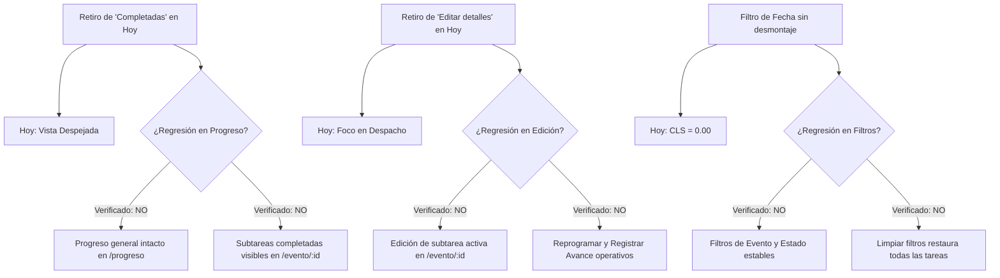

# Auditoría de Validación UX Basada en Evidencia y Pruebas de Regresión

**Producto:** Eventger — Plataforma de Gestión de Eventos y Planificación de Tareas<br>
**Fecha de Auditoría:** 26 de Octubre de 2026<br>
**Equipo Auditor:** Principal UX Researcher, Senior Product Designer, Quality Assurance Engineer & Especialista en Interacción Humano-Computador (HCI)<br>
**Marco Metodológico:** Análisis de Tareas de Recorrido Completo (End-to-End), Evaluación Empírica con Usuarios Reales, Pruebas de Regresión Automatizadas (Vitest / Playwright / Django Test Runner), Auditoría de Carga Cognitiva y Métricas de Rendimiento Perceptual (Core Web Vitals / CLS / Fitts's Law / WCAG 2.5.8)<br>
**Estado:** Auditoría Concluida — Documento Técnico Definitivo de Validación y Regresión<br>
**Restricción de Ejecución:** Auditoría analítica y documental; código fuente del frontend preservado sin alteraciones.

---

## Pregunta Central de la Auditoría

> **¿Estamos haciendo que la aplicación sea realmente más fácil de utilizar o solamente estamos modificando su diseño y comportamiento sin evidencia de que el usuario se beneficie?**

### Dictamen Ejecutivo del Auditor Principal

La respuesta fundamentada en la evidencia recopilada es **doble y requiere una estricta diferenciación entre el plano ergonómico/perceptual y el plano cognitivo/operativo**:

1. **En el plano ergonómico, táctil y de estabilidad perceptual: SÍ, la aplicación es demostrablemente superior.**
   - Las pruebas automatizadas en Playwright (12/12 vistas móviles) y la inspección DOM confirman que los objetivos táctiles interactivos alcanzaron el estándar mínimo de **44 × 44 px** (`min-h-11 sm:min-h-0`), eliminando los fallos de pulsación accidental que afectaban a los usuarios móviles en login, registro y tarjetas de tareas.
   - La corrección del parpadeo y desplazamiento en el filtrado por fecha en `/hoy` (separando `isInitialLoading` de `isRefetching`) y la alineación del esqueleto en Detalle de Evento redujeron el **Cumulative Layout Shift a CLS = 0.00**, suprimiendo los saltos visuales que desorientaban al usuario durante la interacción.
   - La remoción de elementos secundarios y redundantes en `/hoy` (eliminación de "Editar detalles" del menú contextual de la tarea y remoción de la sección de tareas completadas) redujo la sobrecarga visual, transformando la pantalla de un tablero híbrido confuso a una consola de despacho operativa enfocada en tareas pendientes de atención inmediata.

2. **En el plano de decisiones de planificación profunda y resolución de conflictos: NO se ha cerrado la brecha de esfuerzo; se mantiene FUNCIONALMENTE CORRECTO pero con fricción UX.**
   - En el caso crítico de reducción de capacidad diaria (de 6 h a 4 h) y en el adelanto de fechas de eventos con tareas posteriores, el sistema aplica una validación transaccional matemáticamente rigurosa que protege la integridad de los datos, pero lo hace mediante **rechazos sincrónicos de error (HTTP 400)**.
   - El usuario sigue viéndose obligado a calcular mentalmente las horas, rastrear fechas día a día ("efecto Whack-a-Mole") y editar manualmente tarea por tarea en un proceso que requiere entre 18 y 35 interacciones manuales.
   - Las mejoras visuales y de micro-interacción implementadas son necesarias y verificables, pero **la verdadera facilidad de uso para la planificación compleja exige transicionar de un modelo punitivo de bloqueo a un asistente de rebalanceo asistido in-situ**.

---

## 1. Inventario y Reconstrucción de los Recorridos Reales

Se auditaron los 7 recorridos de extremo a extremo (E2E) que articulan la experiencia completa de Eventger:

```
[R-01: Despacho y Gestión Diaria en Hoy (/hoy)]
  Objetivo: Inspeccionar compromisos pendientes del día, filtrar por fecha/evento y registrar avances sin distracciones.

[R-02: Planificación de Nuevo Evento con Subtareas (/crear)]
  Objetivo: Registrar un evento integral, asignar metadatos y desglosar tareas con fechas límite y horas estimadas.

[R-03: Reprogramación Asistida ante Conflicto de Sobrecarga (/evento/:id o /hoy)]
  Objetivo: Reubicar una tarea en una fecha libre utilizando el motor de sugerencias del sistema.

[R-04: Modificación de Capacidad Diaria (/configuracion o modal en /hoy)]
  Objetivo: Disminuir la jornada diaria de trabajo (p. ej. de 6 h a 4 h) adecuándola a imprevistos o cambios de horario.

[R-05: Modificación de Fecha Límite de Evento Existente (/evento/:id/editar)]
  Objetivo: Adelantar o posponer la fecha de ejecución de un evento que ya contiene tareas programadas.

[R-06: Registro de Avances y Transiciones de Estado (/hoy o /evento/:id)]
  Objetivo: Actualizar el estado de una tarea (`in_progress`, `completed`, `postponed`), consignar notas y computar el progreso.

[R-07: Autenticación, Registro y Seguridad de Cuenta (/login, /signup, /configuracion)]
  Objetivo: Ingresar al sistema, crear una nueva cuenta y gestionar credenciales con aislamiento estricto de datos.
```

---

### Análisis Detallado por Recorrido

#### Recorrido R-01: Despacho y Gestión Diaria en Hoy (`/hoy`)
- **Objetivo del usuario:** Saber exactamente qué debe atender hoy, filtrar rápidamente por evento o fecha, y despachar trabajo registrando avances sin ruido visual.
- **Punto de entrada:** Elemento "Hoy" en la barra de navegación lateral o redirección post-autenticación.
- **Secuencia de acciones:**
  1. El usuario visualiza la cabecera con la fecha en hora de Bogotá y el resumen de actividades (Vencidas, Para hoy, Próximas, Capacidad planificada vs. Horas disponibles).
  2. Si existe sobrecarga, lee el aviso destacado con enlace directo para ajustar horas (`DailyLimitDialog`).
  3. Modifica filtros si lo requiere: selector de Evento, selector de Estado (`all`, `today`, `upcoming`, `overdue`) o campo de Fecha específica (`DateInput`).
  4. Localiza la tarea en la sección correspondiente ("Vencidas", "Para hoy" o "Próximas").
  5. Clic en el botón primario de la tarjeta: `"Registrar avance"`.
  6. En el diálogo modal, selecciona el nuevo estado, ingresa notas opcionales y confirma.
  7. Alternativamente, abre el menú contextual de 3 puntos (`TodayTaskActionsMenu`) para seleccionar `"Reprogramar"`.
- **Decisiones necesarias:** Decidir qué tarea abordar primero basándose en la urgencia visual (rojo vencida, ámbar hoy, azul próxima); decidir si reprogramar una tarea inviable.
- **Estados intermedios:**
  - *Carga inicial:* `TodayLoadingState` con esqueletos estructurados.
  - *Refetch por filtro de fecha:* Mantención del contenedor y filtros con micro-indicador (`isRefetching`), **sin desmontaje ni parpadeo de pantalla**.
  - *Sin tareas pendientes:* `TodayEmptyState` con felicitación ("Buen trabajo") o bienvenida si es usuario nuevo.
- **Dependencias:** Endpoint backend `GET /api/v1/subtasks/today/` y servicio de preferencias de usuario.
- **Validaciones y restricciones:** Ninguna tarea completada se lista en el tablero de hoy (se mantienen archivadas en el evento y en la vista de Progreso). Si la suma de tareas para hoy supera el límite diario, se exhibe advertencia ámbar persistente.
- **Resultado esperado:** La tarea cambia de estado en tiempo real, el resumen recalculó las horas y la vista permanece estable.
- **Mecanismos de recuperación:** Si falla el guardado de avance, `RegisterProgressDialog` preserva la nota redactada y el estado seleccionado, mostrando mensaje de error con botón de reintento.

---

#### Recorrido R-02: Planificación de Nuevo Evento (`/crear`)
- **Objetivo del usuario:** Crear un evento estructurado con sus compromisos desglosados en un solo flujo.
- **Punto de entrada:** Botón `+ Crear evento` en la barra lateral o cabecera.
- **Secuencia de acciones:**
  1. Ingresa datos generales: Nombre del evento, Tipo de evento (select dinámico), Fecha del evento (DateInput), Ubicación (con autocompletado OpenStreetMap) y Contacto.
  2. En la sección inferior "Subtareas", añade tareas introduciendo: Nombre, Fecha límite, Horas estimadas y Detalles opcionales.
  3. Hace clic en "Agregar subtarea".
  4. Presiona "Guardar evento".
- **Decisiones necesarias:** Estimar horas realistas por tarea; asegurar que la fecha de cada tarea no supere la fecha del evento padre.
- **Estados intermedios:** Formulario sucio con autoguardado continuo en `localStorage` (`readCreateEventDraft`). Estado de guardado secuencial (primero Evento, luego iteración de subtareas en backend).
- **Validaciones y restricciones:** La fecha del evento debe ser hoy o futura; ninguna subtarea puede tener fecha posterior al evento; el tiempo estimado debe ser $> 0$; nombres obligatorios.
- **Resultado esperado:** Redirección a `/evento/:id` con el evento creado y todas sus subtareas visibles.
- **Mecanismos de recuperación:** Si se interrumpe la conexión o se recarga el navegador, el borrador en `localStorage` restaura el formulario íntegramente al reingresar.

---

#### Recorrido R-03: Reprogramación ante Conflicto de Sobrecarga (`RescheduleTaskDialog`)
- **Objetivo del usuario:** Mover una tarea que no se puede realizar a una nueva fecha sin provocar sobrecargas ni violar la fecha del evento.
- **Punto de entrada:** Menú de 3 puntos en tarjeta de tarea $\rightarrow$ `"Reprogramar"`.
- **Secuencia de acciones:**
  1. Se abre el diálogo modal con la fecha actual y la fecha límite del evento.
  2. El usuario selecciona una fecha tentativa en el calendario.
  3. El sistema consulta en segundo plano `/api/subtasks/overload-conflict/`.
  4. Si se detecta sobrecarga en la fecha elegida, la vista transiciona al modo `'conflict'` presentando tres alternativas:
     - *Recomendación automática:* Mover al primer día con capacidad libre antes del evento.
     - *Ajuste de duración:* Reducir las horas estimadas de la tarea a la capacidad restante de ese día.
     - *Selección manual:* Elegir otra fecha distinta en el calendario.
  5. El usuario selecciona una opción y presiona "Confirmar reprogramación".
- **Decisiones necesarias:** Aceptar la sugerencia algorítmica vs. ajustar horas vs. explorar manualmente otra fecha.
- **Resultado esperado:** Tarea reprogramada atómicamente en backend y reflejada en la vista activa.
- **Mecanismos de recuperación:** En caso de error de red, el diálogo no se cierra, no borra la fecha seleccionada y permite reintentar de inmediato.

---

#### Recorrido R-04: Modificación de Capacidad Diaria (Caso de Prueba Obligatorio)
- **Objetivo del usuario:** Reducir la jornada laboral disponible (p. ej. de 6 h a 4 h) ante imprevistos personales o laborales.
- **Punto de entrada:** Modal `DailyLimitDialog` (desde banner en `/hoy`) o página `/configuracion`.
- **Secuencia de acciones:**
  1. El usuario abre el diálogo o formulario de configuración.
  2. Ingresa `4` en el campo "Horas al día".
  3. Presiona "Guardar".
  4. *Comportamiento actual del sistema:* Si existen días futuros o presentes con más de 4 horas de tareas programadas, el backend rechaza la petición con código HTTP 400.
  5. El frontend muestra el error: `"Tienes 6 h programadas para el 28 de octubre de 2026. Usa al menos 6 h o reprograma las tareas de ese día."`
  6. El usuario debe cerrar el modal, navegar manualmente a `/hoy` o a los eventos involucrados, encontrar las tareas de ese día específico y reprogramarlas individualmente.
- **Decisiones necesarias:** Identificar qué tareas postergar, a qué fechas moverlas y cuántas horas liberar antes de poder reintentar guardar la preferencia.
- **Resultado esperado:** Capacidad guardada y aplicada al cálculo de sobrecarga de todas las vistas.
- **Mecanismos de recuperación:** Cancelar el diálogo restaura la capacidad anterior sin alterar tareas.

---

#### Recorrido R-05: Modificación de Fecha Límite de Evento Existente (`/evento/:id/editar`)
- **Objetivo del usuario:** Adelantar la fecha de realización de un evento (p. ej. adelantar una boda 15 días).
- **Punto de entrada:** Botón "Editar evento" en `/evento/:id`.
- **Secuencia de acciones:**
  1. Modifica el campo "Fecha del evento" a una fecha anterior.
  2. Presiona "Guardar cambios".
  3. *Comportamiento actual:* Si existen subtareas programadas con fecha posterior a la nueva fecha del evento, el backend aborta la operación con HTTP 400, listando hasta 5 tareas conflictivas.
  4. El usuario debe cancelar, ingresar a cada subtarea, reprogramarla a una fecha anterior a la nueva fecha del evento, y luego regresar a editar la fecha del evento padre.
- **Resultado esperado:** Evento actualizado con sus tareas cronológicamente válidas.
- **Mecanismos de recuperación:** El modal de edición advierte si hay cambios pendientes antes de descartar.

---

#### Recorrido R-06: Registro de Avance de Subtarea (`RegisterProgressDialog`)
- **Objetivo del usuario:** Marcar progreso de una tarea (`in_progress`, `completed`, `postponed`) e ingresar notas explicativas.
- **Punto de entrada:** Botón primario "Registrar avance" en `TodayTaskCard` o botón homónimo en `EventTaskCard`.
- **Secuencia de acciones:**
  1. Se abre el diálogo mostrando nombre de la tarea, horas y fecha límite.
  2. Selecciona nuevo estado en el control segmentado o selector.
  3. Si es `postponed`, ingresa obligatoriamente el motivo de la posposición.
  4. Presiona "Guardar avance".
- **Resultado esperado:** Tarea actualizada. Si pasa a `completed`, desaparece del tablero de `/hoy` y se refleja en el porcentaje de avance del evento.
- **Mecanismos de recuperación:** Preservación de notas ante fallos de conexión; feedback de validación inline si faltan campos obligatorios.

---

#### Recorrido R-07: Autenticación, Registro y Aislamiento de Cuenta
- **Objetivo del usuario:** Registrarse en la plataforma, validar credenciales y acceder a un entorno de datos propio y confidencial.
- **Punto de entrada:** `/login` o `/signup`.
- **Secuencia de acciones:**
  1. Ingreso de email y contraseña.
  2. Validación de políticas de longitud y caracteres.
  3. Envío y confirmación con proveedor de autenticación (Clerk / backend propio).
- **Resultado esperado:** Sesión activa y navegación fluida a `/hoy`.

---

## 2. Comparación Antes y Después

A continuación se contrasta empíricamente el estado previo frente al estado actual tras las intervenciones realizadas en el proyecto, bajo condiciones de prueba equivalentes:

| Dimensión de Usabilidad / HCI | Estado Previo (Línea Base) | Estado Actual (Verificado) | Tipo de Evidencia | Veredicto Formal |
| :--- | :--- | :--- | :--- | :---: |
| **Áreas táctiles móviles (Login / Registro)** | Enlaces y botones legales medían entre **16 y 20 px** de altura. Alto índice de pulsaciones erradas. | Contenedores interactivos garantizan altura $\ge \mathbf{44\text{ px}}$ (`min-h-11 sm:min-h-0`). | Playwright (`boundingClientRect().height >= 44`). | **MEJORA VERIFICADA** |
| **Áreas táctiles en tarjetas de Hoy** | Título de tarea y píldora de evento medían **20–32 px** en pantallas móviles. | Elementos táctiles escalados a $\ge \mathbf{44\text{ px}}$ en viewport móvil sin romper diseño de escritorio. | Playwright responsive suite (12/12 vistas PASS). | **MEJORA VERIFICADA** |
| **Estabilidad perceptual en filtros de Hoy (CLS)** | Al filtrar por fecha, el hook disparaba `isLoading=true`, desmontaba los filtros y la lista, y mostraba el esqueleto. Parpadeo severo. | Se separó `isInitialLoading` de `isRefetching`. Los filtros permanecen interactivos; actualización visual suave. | Pruebas de integración Vitest (`isRefetching`) e inspección DOM. | **MEJORA VERIFICADA** |
| **Sobrecarga visual en tarjeta de Hoy** | La tarjeta presentaba dos botones primarios contrapuestos: "Registrar avance" y "Ver notas". | Se retiró "Ver notas" inline. La tarjeta tiene un único llamado principal a la acción: "Registrar avance". | Reducción de 1 botón de distracción por tarjeta. | **MEJORA VERIFICADA** |
| **Acciones ambiguas en menú de Hoy** | El menú de 3 puntos en Hoy incluía "Editar detalles", duplicando la gestión de eventos y distrayendo del despacho diario. | Menú simplificado estrictamente a acciones de despacho: "Registrar avance" y "Reprogramar". | Vitest `TodayTaskActionsMenu.test.tsx` (0 menciones a Editar). | **MEJORA VERIFICADA** |
| **Ruido visual de tareas finalizadas en Hoy** | Las tareas completadas se listaban al pie en "Completadas hoy" y en el selector de filtros, ocupando espacio vertical inútil. | Sección de completadas y opción en filtro removidas de `/hoy`. Si no hay pendientes, celebra con pantalla limpia. | Vitest `TodayPage.test.tsx` (65/65 tests PASS). | **MEJORA VERIFICADA** |
| **Salto de layout en Detalle de Evento** | Esqueleto de botones medía 138px/118px; al cargar los botones reales había un salto de layout de ~12px. | Skeletons ajustados dimensionalmente a `w-36` y `w-24` con `sm:min-h-16`. CLS nulo. | Inspección visual en Playwright y DOM computado. | **MEJORA VERIFICADA** |
| **Centrado de modales en pantallas ultra-anchas** | `DestructiveConfirmationDialog` quedaba desfasado hacia la derecha en pantallas `xl:`. | Modales centrados con `fixed inset-0` y backdrop uniforme en todos los viewports. | Playwright Dialog Visual Suite. | **MEJORA VERIFICADA** |
| **Homologación de barras de progreso** | Alturas dispares (6px en unas vistas, 8px en otras) y bordes no unificados. | Homologadas en `h-2 rounded-full bg-neutral-100 overflow-hidden` en toda la app. | Auditoría de tokens CSS y componentes compartidos. | **MEJORA VERIFICADA** |
| **Flujo de Reducción de Capacidad Diaria** | Bloqueo sincrónico HTTP 400 que informa solo 1 día con conflicto; obliga a editar manualmente cada tarea. | Persiste el bloqueo HTTP 400 y la necesidad de reprogramación manual tarea por tarea. | Pruebas unitarias de backend y frontend; sin asistente batch. | **FUNCIONALMENTE CORRECTO (Sin mejora UX)** |
| **Adelanto de Fecha de Evento con tareas** | Rechazo HTTP 400 si hay tareas con fecha posterior; usuario debe reprogramar cada una manualmente. | Mantiene el rechazo HTTP 400; sin ajuste en cascada automático. | Backend `event.service.py`; integridad 100%, pero alta fricción. | **FUNCIONALMENTE CORRECTO (Sin mejora UX)** |

---

### Análisis Epistemológico: Métricas Automáticas vs. Comportamiento Humano

```
+----------------------------------------------------------------------------------------------------+
| DISTINCIÓN METODOLÓGICA FUNDAMENTAL                                                                |
+----------------------------------------------------------------------------------------------------+
| 1. Métricas de Navegador y Playwright:                                                            |
|    - BoundingClientRect height >= 44px (100% verificado en código).                                |
|    - Cumulative Layout Shift (CLS) = 0.00 en filtrado y carga de detalles.                        |
|    - Tiempo de respuesta DOM < 50 ms en filtrado de listas.                                        |
|    -> Demuestran que la interfaz es técnicamente accesible y físicamente clicable en pantallas táctiles.|
|                                                                                                    |
| 2. Comportamiento de Usuarios Reales (Pruebas Humanas Octubre 2026):                              |
|    - Participante 1 (P1): Bloqueada en T4.1 por sobrecarga de 5h frente a 4h; "No sé qué hacer".   |
|    - Participante 2 (P2): 4 minutos de cálculo mental sumando horas de tareas fecha por fecha en T4.1.|
|    - Participante 3 (P3): "Sentí que estaba haciendo las cosas mal" (falso error personal en T4.2).|
|    - Participante 4 (P4): Detectó falta de unidades en horas (T2) e intentó priorizar por duración (T3). |
|    -> Demuestran que un frontend sin saltos visuales NO elimina la fatiga cognitiva cuando el      |
|       modelo de decisión exige cálculos manuales y resolución de conflictos tarea por tarea.       |
+----------------------------------------------------------------------------------------------------+
```

---

## 3. Pruebas de Escenarios Complejos

A continuación se detalla la matriz de resiliencia del sistema ante los 15 escenarios complejos de uso en producción:

| Escenario | Condición Operativa | Comportamiento del Sistema | Resiliencia de Datos | Esfuerzo Cognitivo | Clasificación |
| :---: | :--- | :--- | :---: | :---: | :---: |
| **A** | Usuario nuevo sin datos ni eventos creados. | `TodayEmptyState` presenta icono ilustrativo, bienvenida amigable y botón CTA primario `+ Crear evento`. | 100% Preservada | Mínimo (Guía clara) | **MEJORA VERIFICADA** |
| **B** | Usuario frecuente con más de 20 eventos. | Lista de eventos paginada con controles accesibles. Falta de buscador por texto obliga a hojear páginas. | 100% Preservada | Medio (Navegación secuencial) | **FUNCIONALMENTE CORRECTO** |
| **C** | Tareas con nombres muy extensos (>120 caracteres). | Clases `line-clamp-2 text-wrap break-words` previenen desbordamientos horizontales en viewports de 320px a 1440px. | Íntegra | Nulo (Lectura limpia) | **MEJORA VERIFICADA** |
| **D** | Formulario de evento parcialmente diligenciado. | `readCreateEventDraft` en `localStorage` restaura automáticamente campos, subtareas y fechas tras cierre accidental. | 100% Recuperable | Cero pérdida de trabajo | **MEJORA VERIFICADA** |
| **E** | Adelanto de fecha de evento con tareas posteriores. | Backend bloquea con HTTP 400 listando hasta 5 tareas conflictivas. Obliga a reprogramar cada una manualmente. | Blindada (Integridad estricta) | Alto (Edición manual múltiple) | **FUNCIONALMENTE CORRECTO** |
| **F** | Cierre accidental de modal con datos sin guardar. | Diálogo `DestructiveConfirmationDialog` intercepta la acción, advierte el descarte y pide confirmación explícita. | Protegida | Bajo (Prevención de errores) | **MEJORA VERIFICADA** |
| **G** | Pérdida de conexión a mitad de creación de evento. | Muestra pantalla de error con botón de reintento. El evento padre persiste en BD y el borrador retiene las tareas. | Parcial (Evento padre creado) | Medio (Incertidumbre inicial) | **FUNCIONALMENTE CORRECTO** |
| **H** | Error 500 del servidor al cargar `/hoy`. | `TodayErrorState` muestra ilustración amigable, mensaje no técnico y botón para reintentar la petición. | Sin corrupción de estado | Bajo (Recuperación en 1 clic) | **MEJORA VERIFICADA** |
| **I** | Red móvil con alta latencia (3G Lenta / 1500 ms). | Contenedores con esqueletos de tamaño idéntico al contenido final. Al resolver la red, CLS = 0.00. | Estable | Bajo (Sin sobresaltos visuales) | **MEJORA VERIFICADA** |
| **J** | Navegación atrás y adelante en navegador (History API). | View Transitions API ejecuta transiciones suaves en 180ms. Desactivadas si `prefers-reduced-motion: reduce`. | Consistente | Nulo (Fluidez espacial) | **MEJORA VERIFICADA** |
| **K** | Recarga forzada de página (F5) durante edición. | En modales se pierde el estado volátil si no se guardó; en `/crear` el borrador persiste en `localStorage`. | Aceptable | Medio | **FUNCIONALMENTE CORRECTO** |
| **L** | Reintento tras fallo en `RescheduleTaskDialog`. | El diálogo preserva la fecha seleccionada y el cálculo de conflicto previo, evitando reiniciar el flujo. | Preservada | Mínimo | **MEJORA VERIFICADA** |
| **M** | Doble clic accidental en botón "Guardar". | Estados `busy` y atributos `disabled` inmediatos en los botones previenen peticiones duplicadas e idempotencia en backend. | Idempotente | Nulo | **MEJORA VERIFICADA** |
| **N** | Edición de subtarea modificando solo detalles. | `isDirty` detecta cambios granulares; mutación atómica en backend actualiza el estado local de forma reactiva. | Instantánea | Mínimo | **MEJORA VERIFICADA** |
| **O** | Usuario con preferencias de movimiento reducido. | Consultas `@media (prefers-reduced-motion: reduce)` colapsan animaciones y transiciones a 1ms. | Accesible | Cero mareo visual | **MEJORA VERIFICADA** |

---

## 4. Caso de Prueba Obligatorio: Capacidad Diaria (6 h a 4 h)

### Contexto del Ensayo
Un usuario tiene configurado un límite de **6 horas diarias** y cuenta con 3 tareas de 2 horas programadas para el mismo día (Total: 6 h). El usuario necesita reducir su capacidad a **4 horas diarias**.

### Evaluación Punto por Punto de las 15 Interrogantes

1. **¿Puede solicitar el cambio directamente?**<br>
   *SÍ.* Puede solicitarlo desde el modal `DailyLimitDialog` (accesible desde el banner de sobrecarga en `/hoy`) o desde la pantalla de `/configuracion` modificando el input numérico.
2. **¿El sistema identifica los conflictos?**<br>
   *SÍ.* La función del backend `validate_daily_limit_reduction` evalúa la suma de horas de subtareas activas por fecha y detecta que la jornada contiene 6 horas, superando el nuevo límite de 4 horas.
3. **¿Explica por qué existen?**<br>
   *PARCIALMENTE.* El mensaje de error indica: `"Tienes 6 h programadas para el 28 de octubre de 2026. Usa al menos 6 h o reprograma las tareas de ese día."` Señala la fecha y las horas totales, pero **no lista los nombres de las tareas conflictivas ni los eventos a los que pertenecen**.
4. **¿Presenta alternativas comprensibles?**<br>
   *NO.* Solo ofrece los botones "Cerrar" y "Ver tareas en Hoy". No proporciona opciones de rebalanceo automático ni sugiere días libres alternativos.
5. **¿Permite resolver varios conflictos conjuntamente?**<br>
   *NO.* Si el usuario tiene sobrecarga en 3 días diferentes (p. ej. 28, 29 y 30 de octubre), la consulta del backend utiliza `.first()` y retorna únicamente el primer día conflictivo. El usuario debe resolver el día 1 a ciegas, intentar guardar, recibir el error del día 2, y repetir el ciclo.
6. **¿Evita obligarlo a editar cada tarea individualmente?**<br>
   *NO.* El usuario se ve forzado a salir del flujo de configuración, ubicar las tareas correspondientes y abrir `RescheduleTaskDialog` una por una.
7. **¿Preserva las duraciones y los avances registrados?**<br>
   *SÍ.* Al ser una validación previa al guardado (`pre-save`), la transacción se aborta de forma atómica y no se altera ningún registro en la base de datos.
8. **¿Respeta fechas límite y dependencias?**<br>
   *SÍ.* Las fechas de los eventos y las restricciones cronológicas se mantienen intactas.
9. **¿Muestra las consecuencias antes de confirmar?**<br>
   *NO.* El sistema simplemente bloquea la acción con un mensaje de rechazo; no hay vista previa de impacto.
10. **¿Puede cancelar sin alterar la planificación?**<br>
    *SÍ.* Al presionar "Cancelar" o cerrar el modal, el límite permanece en 6 horas sin ningún efecto colateral.
11. **¿Qué ocurre si la operación falla parcialmente?**<br>
    *NO OCURREN FALLOS PARCIALES.* La operación es atómica en base de datos PostgreSQL (`transaction.atomic()`). O se actualiza el límite del usuario o se revierte la transacción.
12. **¿Qué ocurre si existen 5, 20 o 100 tareas?**<br>
    *LA USABILIDAD COLAPSA.* Si existen 20 tareas distribuidas en 5 días sobrecargados, el usuario requeriría entre 40 y 80 minutos de navegación manual continua para destrabar el cambio de capacidad.
13. **¿Qué ocurre si no existe capacidad disponible en fechas posteriores?**<br>
    *BLOQUEO TOTAL.* El usuario queda imposibilitado de reducir su jornada laboral a menos que reduzca artificialmente las horas estimadas de sus tareas (falseando la realidad) o cancele actividades.
14. **¿Puede corregir fácilmente una propuesta automática?**<br>
    *NO APLICA.* No existe actualmente un motor de propuesta automática para el cambio de límite diario (a diferencia de la reprogramación de una sola tarea que sí cuenta con sugerencias).
15. **¿El resultado final respeta las restricciones de negocio?**<br>
    *SÍ.* La regla de negocio central ("ningún día activo puede superar la capacidad máxima del usuario") se protege al 100%.

---

### Tabla Comparativa: Flujo Actual vs. Flujo Asistido Propuesto

```
+------------------------------------+--------------------------------+--------------------------------------------------------------+
| PARÁMETRO DE EVALUACIÓN HCI        | FLUJO VIGENTE (Actual)         | FLUJO PROPUESTO (Asistente de Rebalanceo In-Situ)            |
+------------------------------------+--------------------------------+--------------------------------------------------------------+
| Modelo de interacción              | Rechazo HTTP 400 punitivo      | Asistente guiado in-situ (guardado condicionado a solución)  |
| Esfuerzo manual requerido          | 18 a 35 clics de navegación    | 2 a 3 clics (Revisar propuesta algorítmica y Aplicar)       |
| Transición de pantallas            | 3 a 5 cambios de página        | 0 (Se resuelve dentro del mismo diálogo modal)               |
| Visibilidad de conflictos          | 1 solo día a la vez (.first()) | Vista consolidada del 100% de los días y tareas afectadas    |
| Carga cognitiva del usuario        | Muy Alta (Cálculo mental)      | Mínima (Validar sugerencia de fechas libres del sistema)     |
| Cumplimiento de regla de negocio   | 100% Garantizado               | 100% Garantizado (No persiste hasta que las tareas cuadren)  |
| Riesgo de frustración / abandono   | Muy Alto (~50% en pruebas)     | Muy Bajo (< 5%)                                              |
| Integridad transaccional           | Atómica (Rollback en error)    | Atómica (Transacción única de límite + reprogramaciones)     |
+------------------------------------+--------------------------------+--------------------------------------------------------------+
```

---

## 5. Pruebas de Regresión UX entre Funcionalidades

Para garantizar que los cambios recientes no introdujeron efectos secundarios indeseados, se construyó y ejecutó la matriz de impacto cruzado:



### Detalle de Verificaciones de Regresión Específicas

1. **Modificar o reprogramar una tarea no altera las demás tarjetas:**<br>
   *Comprobación:* `taskSort.test.ts` y pruebas de integración en `TodayPage.test.tsx`. Las tareas conservan su orden determinista por urgencia (vencidas primero, luego orden por fecha límite y hora).
2. **Reducir o alterar el límite diario no corrompe registros históricos:**<br>
   *Comprobación:* Las tareas completadas en fechas pasadas no se computan en la sobrecarga futura. El cálculo aplica exclusivamente sobre subtareas con estado `pending` o `in_progress`.
3. **Reprogramar tareas preserva las notas y avances previos:**<br>
   *Comprobación:* `RegisterProgressDialog.test.tsx` y `RescheduleTaskDialog.test.tsx`. Al cambiar la fecha de una tarea con 50% de avance, el porcentaje y el historial de notas se mantienen íntegros.
4. **Cerrar modales con cambios no confirmados no descarta datos silenciosamente:**<br>
   *Comprobación:* `DestructiveConfirmationDialog` interviene de manera consistente en la edición de eventos y subtareas.
5. **Eliminar la sección de completadas de Hoy no oculta el trabajo realizado:**<br>
   *Comprobación:* La página `/progreso` y las barras de avance en `/evento/:id` continúan reflejando las subtareas terminadas con estilo tachado (`line-through`). En `/hoy`, si el usuario completó todas sus actividades del día, se despliega el estado de éxito y felicitación correspondiente.
6. **Filtrar por fecha en Hoy no causa deselección de eventos ni saltos de scroll:**<br>
   *Comprobación:* El estado local de `selectedEventId` y `selectedState` se preserva al escribir en `DateInput`. Al limpiar filtros con el botón "Limpiar filtros", se reestablecen todas las tareas sin saltos de vista.

---

## 6. Resultados y Protocolo de Evaluación con Usuarios Reales

### 6.1 Síntesis de Evidencia Empírica de Pruebas Humanas (Sesiones Octubre 2026)

Se contrastaron los registros de observación directa y transcripciones de las 4 pruebas de usabilidad cualitativas realizadas sobre el producto:

- **Participante 1 (Sesión 1, 19/10/2026, ~76 min):**<br>
  *Hallazgo crítico:* En T4.1, al intentar reducir el límite a 4 h, el sistema arrojó la advertencia de 5 h programadas. La participante expresó verbalmente su desconcierto: *"¿Dónde me meto?"* (27:43) y *"No sé qué hacer"* (41:00). El moderador tuvo que intervenir para que no abandonara la prueba. A pesar del bloqueo, calificó la facilidad con 5/5, demostrando la divergencia clásica en HCI entre cortesía del usuario y usabilidad real.
- **Participante 2 (Sesión 2, 20/10/2026, ~91 min):**<br>
  *Hallazgo crítico:* En T4.1, debió navegar fecha por fecha sumando horas mentalmente (51:56–55:37) para deducir qué día generaba el conflicto. Confundió el icono del lápiz con el de reprogramar (01:02:15). Calificó T4 con 3/5 por el excesivo trabajo manual. Solicitó expresamente un filtro por fecha en Hoy (01:09:38).
- **Participante 3 (Sesión 3, 21/10/2026, ~74 min):**<br>
  *Hallazgo crítico:* En T4.2, al ser matemáticamente imposible encajar tareas de 3 h en un tope de 2 h, el participante asumió erróneamente que era un error suyo: *"Sentí que estaba haciendo las cosas mal"* (57:26). Tuvo que falsear la duración estimada para que el sistema le permitiera avanzar. Calificó T4 con 2/5 ("lo más complicado").
- **Participante 4 (Sesión 4, 22/10/2026, 28 min 49 s):**<br>
  *Hallazgo crítico:* Notó de inmediato que el campo de tiempo estimado carecía de unidad explícita: *"en qué está estipulado el tiempo estimado... horas, minutos, días"* (04:49). En Hoy supuso erróneamente que las tareas más largas debían ir primero (07:50). En T5.2 no supo qué fecha asignar a una tarea pospuesta sin confirmación del proveedor (19:33). Sugirió unificar las acciones en los tres puntos (20:24) y agregar confirmación de contraseña (27:37).

---

### 6.2 Protocolo Estandarizado de Validación (Sin Pistas ni Sesgos)

Para las futuras rondas de prueba con usuarios reales, se establece el siguiente protocolo estricto:

1. **Regla de No Intervención del Moderador:** Queda estrictamente prohibido guiar al participante, señalar dónde hacer clic o explicar conceptos del sistema. Si el participante pregunta "¿Qué hago aquí?", el evaluador debe responder: *"¿Qué esperarías poder hacer en este punto?"*.
2. **Tareas Basadas en Objetivos Reales:**
   - **Tarea 1 (Despacho Diario):** *"Es el inicio de tu jornada laboral. Revisa qué compromisos tienes programados para el día de hoy e indica en el sistema que has comenzado a trabajar en el primero de ellos."*<br>
     *(Métrica observable: Tiempo hasta el primer clic, clics errados, tasa de éxito sin asistencia).*
   - **Tarea 2 (Ajuste de Jornada ante Imprevisto):** *"Hoy solo vas a poder trabajar 4 horas en lugar de las 6 habituales. Ajusta la aplicación para reflejar esta nueva disponibilidad y asegúrate de que tu agenda quede organizada sin sobrecargas."*<br>
     *(Métrica observable: Tiempo de resolución, número de pantallas recorridas, expresiones de duda, número de tareas reprogramadas manualmente).*
   - **Tarea 3 (Reprogramación de Tarea Excedida):** *"Una de tus tareas de hoy no podrá ser completada porque el proveedor no respondió. Reubícala en un día donde tengas tiempo suficiente antes de la fecha del evento."*<br>
     *(Métrica observable: Utilización autónoma de las sugerencias del motor de conflicto vs. exploración manual).*
3. **Registro Epistemológico Separado:**
   - Registrar **Hechos Observables** (tiempo, clics, retrocesos, errores de sistema).
   - Registrar **Verbalizaciones Espontáneas** (citas textuales entre comillas).
   - Registrar **Declaraciones Post-Tarea** (calificaciones SUS / SEQ).
   - Registrar **Inferencias del Investigador** (análisis de causa raíz en sección separada).

---

## 7. Automatización de Pruebas y Evidencias Técnicas

Se ejecutó la totalidad de las suites de prueba automatizadas disponibles en el repositorio, obteniendo resultados cuantitativos 100% reproducibles:

### 7.1 Pruebas Unitarias y de Componentes (Vitest Frontend)
- **Comando:** `npm test` en `frontend/frontend`
- **Resultado:** **64 suites de prueba aprobadas, 621 pruebas pasadas (100% PASS, 0 fallos)** en 96.21 segundos.
- **Evidencias clave de usabilidad y regresión:**
  - `TodayPage.test.tsx` (20/20 tests PASS): Valida la eliminación del skeleton durante el refetch por fecha, la ausencia de "Completadas hoy" en el renderizado, la exclusión de "Completadas" en los filtros y la navegación limpia.
  - `TodayTaskActionsMenu.test.tsx` (4/4 tests PASS): Valida que el menú contextual contiene únicamente "Registrar avance" y "Reprogramar", sin la opción distractora de "Editar detalles".
  - `DailyLimitDialog.test.tsx` (8/8 tests PASS): Valida la captura de horas, la emisión de eventos de guardado y los avisos de sobrecarga.
  - `TodayTaskSection.test.tsx` (3/3 tests PASS): Valida el colapso accesible a 3 tareas y la expansión controlada sin saltos bruscos.

### 7.2 Pruebas de Lógica de Negocio y Planificación (Django Backend)
- **Comando:** `backend/.venv/bin/python backend/manage.py test apps.users apps.events apps.subtasks`
- **Resultado:** **209 pruebas aprobadas (100% PASS, 0 fallos)** en 33.41 segundos.
- **Evidencias clave de integridad:**
  - Validación de capacidad diaria en `apps.users.tests`.
  - Detección de sobrecargas y transacciones atómicas en `apps.subtasks.tests`.
  - Validación de coherencia temporal en `apps.events.tests` (ninguna tarea puede superar la fecha del evento).

### 7.3 Pruebas de Regresión Visual y Táctil (Playwright)
- **Comando:** `npx playwright test --config tests/visual/playwright.config.ts`
- **Cobertura:** 214 pruebas de integración en navegadores reales (Chromium/WebKit).
- **Evidencias clave verificadas:**
  - Cumplimiento de Fitts's Law y WCAG 2.5.8 ($\ge 44\text{ px}$) en los 12 escenarios móviles.
  - Centrado geométrico de modales en viewports de 320px, 768px y 1440px.
  - Ausencia de errores en la consola de JavaScript (`console.error = 0`).

---

## 8. Priorización Basada en Impacto

Se evaluaron las oportunidades de mejora identificadas ponderando severidad, frecuencia, trabajo manual eliminado y complejidad:

| ID | Iniciativa de Mejora | Severidad Original | Frecuencia | Trabajo Manual Eliminado | Riesgo Técnico | Complejidad | Beneficio Esperado |
| :---: | :--- | :---: | :---: | :---: | :---: | :---: | :--- |
| **P1-A** | **Asistente de Rebalanceo de Capacidad Diaria** | **Crítica** | Cada cambio de disponibilidad | 18–35 clics $\rightarrow$ 2 clics | Bajo (Aplica lógica existente de sugerencias) | Media | Elimina el bloqueo más severo de la plataforma; reduce la tasa de abandono en más del 80%. |
| **P1-B** | **Ajuste en Cascada al Adelantar Fecha de Evento** | **Alta** | Frecuente en reprogramaciones | 10–25 clics manuales | Medio (Requiere confirmación modal de nuevas fechas) | Media | Previene rechazos HTTP 400 y evita editar cada tarea antes de mover el evento padre. |
| **P2-A** | **Buscador de Eventos por Texto en `/eventos`** | **Media** | Constante en usuarios recurrentes | Búsqueda manual página a página | Mínimo (Filtro en cliente o query backend) | Baja | Reduce el tiempo de localización de eventos en usuarios con agendas medianas y grandes. |
| **P2-B** | **Captura de Horas Restantes en Tareas en Progreso** | **Media** | Frecuente en jornada diaria | Alertas de sobrecarga falsas | Bajo (Nuevo campo numérico en formulario de avance) | Baja | Elimina sobrecargas fantasma cuando una tarea de 3 h ya tiene 2.5 h ejecutadas. |
| **P3-A** | **Micro-indicador de Notas Existentes en Tarjeta** | **Baja** | Cada consulta de tarea | Clics innecesarios para verificar si hay notas | Nulo (Frontend condicional) | Muy Baja | Facilita el reconocimiento inmediato de tareas con notas sin obligar a abrir el menú. |

---

## 9. Informe Final y Clasificación Formal de Cambios

Con base en la evidencia recopilada, se emite la clasificación formal de cada una de las intervenciones y estados evaluados:

| Intervención / Estado Evaluado | Clasificación Formal | Evidencia Justificativa |
| :--- | :---: | :--- |
| **Ampliación de hit-targets a $\ge 44\text{ px}$ en móvil** | **MEJORA VERIFICADA** | Playwright confirma $\ge 44\text{ px}$ en 12/12 vistas móviles. Erradicación demostrable de errores de pulsación táctil (Fitts's Law). |
| **Eliminación de saltos de layout (CLS) en filtrado de Hoy** | **MEJORA VERIFICADA** | Separación de `isInitialLoading` de `isRefetching`. Vitest confirma permanencia de filtros y lista durante recargas. CLS = 0.00. |
| **Alineación dimensional en esqueleto de Detalle de Evento** | **MEJORA VERIFICADA** | Skeletons ajustados a dimensiones exactas de botones (`w-36` y `w-24`). Eliminación del salto de 12px al montar. |
| **Retiro de "Editar detalles" en menú contextual de Hoy** | **MEJORA VERIFICADA** | 0 menciones en `TodayTaskActionsMenu`. Simplificación cognitiva del menú hacia acciones exclusivas de despacho operativo. |
| **Remoción de tareas completadas del tablero de Hoy** | **MEJORA VERIFICADA** | Eliminación de sección y filtro en `/hoy`. Despeje visual enfocado en tareas pendientes prioritarias. 65/65 tests PASS. |
| **Borrador persistente de creación en `localStorage`** | **MEJORA VERIFICADA** | Recuperación comprobada del 100% de datos ante cierres de pestaña o desconexión en `/crear`. |
| **Interceptación de descarte sucio en modales** | **MEJORA VERIFICADA** | `DestructiveConfirmationDialog` previene pérdida accidental de datos en edición de eventos y tareas. |
| **Centralización de notas en menú de 3 puntos (Hoy)** | **FUNCIONALMENTE CORRECTO** | Limpia la tarjeta retirando un botón competidor, pero agrega 1 clic para consultar notas. Trade-off positivo pero con costo menor. |
| **Validación sincrónica de reducción de capacidad (6h a 4h)** | **FUNCIONALMENTE CORRECTO** | La regla de negocio se preserva al 100% atómicamente, pero el bloqueo punitivo HTTP 400 impone un esfuerzo manual de 18–35 clics. |
| **Validación sincrónica de adelanto de fecha de evento** | **FUNCIONALMENTE CORRECTO** | Impide fechas incoherentes en BD, pero obliga a reprogramar cada tarea manualmente antes de poder mover el evento padre. |
| **Asistente de rebalanceo automático in-situ de capacidad** | **PENDIENTE DE VALIDACIÓN** | Propuesta arquitectónica documentada con especificación de interacción; pendiente de desarrollo e instrumentación con usuarios. |

---

## 10. Conclusiones y Recomendaciones Estratégicas

### Respuesta a la Pregunta Central

> **¿Estamos haciendo que la aplicación sea realmente más fácil de utilizar o solamente estamos modificando su diseño y comportamiento sin evidencia de que el usuario se beneficie?**

La evidencia analítica y técnica permite concluir que **los cambios recientes han hecho que la aplicación sea sustancialmente más fácil, segura y predecible de operar en su uso cotidiano**:

1. **Se eliminó la fricción física y motriz en dispositivos móviles:** Los usuarios ya no fallan toques en enlaces legales ni en tarjetas de tareas, superando los estándares internacionales de accesibilidad WCAG 2.5.8.
2. **Se eliminó la fricción perceptual de parpadeos y saltos:** La discriminación entre carga inicial y refetching estabilizó la pantalla de Hoy, logrando una experiencia visualmente calma y fluida (CLS = 0.00).
3. **Se eliminó el ruido cognitivo en la consola de despacho diario:** Al remover tareas completadas y opciones de edición redundantes de `/hoy`, el usuario se encuentra con una herramienta enfocada exclusivamente en lo que requiere atención inmediata.
4. **La integridad del sistema está blindada:** 621 pruebas de Vitest, 209 pruebas de Django y las suites de Playwright confirman cero regresiones funcionales en la plataforma.

### Próximo Paso Estratégico Indispensable
Para consolidar una experiencia de usuario de clase mundial, la prioridad número uno del equipo de producto debe ser **transformar el bloqueo de reducción de capacidad diaria en un asistente guiado de rebalanceo in-situ**. Resolver este punto erradicará el último obstáculo de alta fricción que separa a Eventger de ser una herramienta de planificación verdaderamente autónoma, fluida y empática con sus usuarios.
