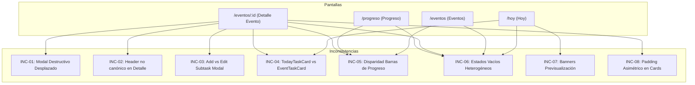

# Informe de Auditoría de Consistencia Visual y Estructural
**Aplicación Web: Eventger Frontend**<br>
**Fecha de Evaluación:** 26 de Octubre de 2026<br>
**Rol del Auditor:** Senior UI/UX Designer & Design Systems Specialist<br>
**Estado:** Correcciones Implementadas y Validadas con Éxito (Tests & Visual Checks)<br>

---

## 1. Resumen de Consistencia Visual General

La aplicación **Eventger** presenta una identidad visual moderna, sobria y atractiva, fundamentada en una paleta de color profesional con acentos índigo (`primary: #4f46e5`), fondos neutros sutiles (`bg-surface-subtle: #fafbfd`, `bg-neutral-bg: #f8fafc`), bordes suaves (`border-border-subtle: #dde2ea`) y una jerarquía tipográfica limpia basada en la fuente *Plus Jakarta Sans*.

A nivel de arquitectura CSS y tokens de diseño, la aplicación ha establecido una base sólida mediante utilidades en `@layer components` en `src/index.css`:
- `.type-page-title` (24px / 1.5rem, weight 600, leading 30px)
- `.type-dialog-title` (20px / 1.25rem, weight 600, leading 22px)
- `.type-section-title` (20px / 1.25rem, weight 600)
- `.type-card-title` (16px / 1rem, weight 600)
- `.type-body` (14px / 0.875rem, weight 400)
- `.type-supporting` (14px / 0.875rem, weight 400, text-neutral-light)
- `.type-caption` (12px / 0.75rem, weight 500)
- `.type-button` (14px / 0.875rem, weight 600)

### Diagnóstico Global
- **Consistencia Estructural Global:** **84 / 100**. Las pantallas principales (`/hoy`, `/eventos`, `/progreso`, `/configuracion`) comparten una cáscara estructural predecible compuesta por `PageContainer`, `PageContent` y `PageHeader`.
- **Áreas Críticas de Incoherencia:**
  1. **Alineación de Diálogos:** `DestructiveConfirmationDialog` introduce offsets asimétricos arbitrarios en pantallas de escritorio (`xl:left-[calc(50%+120px)]`), desviándose del centrado canónico del resto de modales y dejando el sidebar sin cubrir por el overlay de oscurecimiento.
  2. **Encabezado en Detalle de Evento:** `EventDetailContent` omite el patrón `PageHeader`, construyendo un encabezado con anchos de botón rígidos (`sm:w-[138px]`, `sm:w-[118px]`) y colores destructivos fuera de token (`#c9413b` en vez de `#b42318`).
  3. **Disparidad Crear vs. Editar:** `AddSubtaskDialog` (840px de ancho con cajas seccionadas tipo card) y `EditSubtaskDialog` (640px de ancho con layout plano de dos columnas y badge de icono) tratan la misma entidad con dos lenguajes de diseño desconectados.
  4. **Micro-divergencias en Tarjetas de Subtareas:** `TodayTaskCard` y `EventTaskCard` presentan pequeñas divergencias en el grosor tipográfico del botón de acción (`font-semibold` vs `font-medium`), el dimensionamiento del badge de estado (`min-w-[80px]` elástico vs `w-[112px]` fijo), y la profundidad de sombra (`shadow-xs` vs `shadow-sm`).

---

## 2. Inventario de Familias de Componentes

| Familia de Componentes | Componentes Identificados | Archivos Fuente Principales | Función y Propósito |
| :--- | :--- | :--- | :--- |
| **Cards & Contenedores Primarios** | `EventCard`, `EventInfoCard`, `EventProgressCard`, `PageContainer`, `PageContent` | `src/features/events/components/EventCard.tsx`, `src/features/events/components/detail/EventInfoCard.tsx`, `src/components/layout/PageContainer.tsx` | Contenedores de superficie blanca (`rounded-2xl`, `border-border-subtle`, `shadow-xs`) para agrupar entidades clave. |
| **Cards Secundarias (Items de Lista)** | `TodayTaskCard`, `EventTaskCard`, `SubtaskList` | `src/features/today/components/TodayTaskCard.tsx`, `src/features/events/components/detail/EventTaskCard.tsx` | Unidades de trabajo interactivo con barra de acento lateral del color del evento, metadatos y acciones rápidas. |
| **Botones & Acciones** | `Button` (variantes: default, outline, secondary, ghost, destructive, link; tamaños: sm, md, lg, icon), `ActionMenu` | `src/components/ui/button.tsx`, `src/components/ui/action-menu.tsx` | Controles de disparo de acción, navegación y apertura de menús contextuales. |
| **Modales & Diálogos** | `DestructiveConfirmationDialog`, `AddSubtaskDialog`, `EditSubtaskDialog`, `RescheduleTaskDialog`, `RegisterProgressDialog`, `DailyLimitDialog`, `AccountDialog`, `LegalTermsModal` | `src/features/events/components/detail/DestructiveConfirmationDialog.tsx`, `src/features/events/components/detail/AddSubtaskDialog.tsx`, `src/features/today/components/RegisterProgressDialog.tsx`, etc. | Ventanas emergentes de foco contextual construidas sobre primitivas Radix Dialog. |
| **Feedback, Estados Vacíos & Alertas** | `TodayEmptyState`, `EmptyEventsState`, `EmptyTasksState`, `ProgressPage` empty view, banners de confirmación | `src/features/today/components/TodayEmptyState.tsx`, `src/features/events/components/EmptyEventsState.tsx`, `src/features/events/components/detail/EmptyTasksState.tsx` | Pantallas de guía cuando no existen registros; badges semánticos de advertencia o reprogramación. |
| **Formularios & Controles de Entrada** | `Input`, `Select`, `Label`, `Textarea`, `Slider` (Daily Limit) | `src/components/ui/input.tsx`, `src/components/ui/label.tsx`, `src/features/settings/components/DailyLimitDialog.tsx` | Campos de captura de datos con foco unificado en anillo índigo (`ring-primary/20`). |
| **Encabezados de Página** | `PageHeader`, `EventDetailHeader` (ad-hoc) | `src/components/layout/PageHeader.tsx`, `src/features/events/components/detail/EventDetailContent.tsx` | Área superior que define el título principal, subtítulo explicativo y acciones primarias de la vista. |
| **Navegación & Menús** | `Sidebar`, `MobileHeader`, `NavLinks`, `UserMenu` | `src/components/layout/Sidebar.tsx`, `src/components/layout/MobileHeader.tsx` | Enrutamiento principal accesible en panel lateral fijo (desktop) o cajón colapsable con hamburguesa (móvil). |
| **Indicadores de Progreso** | Barra de progreso en `EventCard`, `ProgressPage`, `EventProgressCard` | `src/features/events/components/EventCard.tsx`, `src/features/progress/pages/ProgressPage.tsx` | Visualización cuantitativa del porcentaje completado y tiempo restante. |
| **Badges, Etiquetas & Micro-estados** | `Badge` (Pendiente, En Progreso, Completada, Reprogramada), Prioridad (Alta, Media, Baja), chips de evento | `src/components/ui/badge.tsx`, `TodayTaskCard.tsx`, `EventTaskCard.tsx` | Indicadores de taxonomía y estado con fondos pastel y bordes coordinados. |

---

## 3. Patrones Compartidos Identificados (Referencias de Diseño)

Los siguientes patrones representan la "norma de diseño" del sistema, con la cual deben alinearse los componentes equivalentes:

1. **Estructura de Página Estándar:**
   - Contenedor: `PageContainer` con ancho máximo fluido, padding responsivo `px-4 sm:px-6 lg:px-8 py-6 sm:py-8`.
   - Encabezado: `PageHeader` con `flex min-h-16 items-start justify-between gap-4`. Título en `.type-page-title` (`text-neutral-dark`, 24px) y subtítulo en `.type-supporting` (`text-neutral-light`, 14px).
2. **Superficie de Tarjeta Primaria:**
   - `rounded-2xl border border-border-subtle bg-white shadow-xs p-4 sm:p-6`.
   - Borde sutil `#dde2ea` y fondo blanco puro que destaca sobre `#fafbfd` o `#f8fafc`.
3. **Superficie de Tarjeta Secundaria (Item de Tarea):**
   - `relative rounded-xl border border-border-subtle bg-white p-3.5 sm:p-4 shadow-xs hover:border-neutral-300 transition-all`.
   - Barra de acento vertical a la izquierda indicando el color cromático del evento asociado.
4. **Sistema de Acciones y Botones:**
   - Botón Primario: `h-10 px-4 py-2 rounded-xl bg-primary text-white hover:bg-primary-hover shadow-xs font-semibold text-sm focus-visible:ring-2 focus-visible:ring-primary/20`.
   - Botón Secundario / Outline: `h-10 px-3.5 py-2 rounded-xl border border-border-subtle bg-white text-neutral-dark hover:bg-neutral-light/50 font-medium text-sm`.
   - Botón Icono: `size-9 rounded-lg border border-border-subtle hover:bg-neutral-light/30`.
5. **Diálogos Modales Base:**
   - Overlay: `fixed inset-0 z-50 bg-black/40 backdrop-blur-xs`.
   - Contenedor Modal: `fixed left-1/2 top-1/2 z-50 -translate-x-1/2 -translate-y-1/2 w-[calc(100%-2rem)] max-w-lg rounded-2xl border border-border-subtle bg-white p-6 shadow-xl`.
   - Encabezado: Título en `.type-dialog-title` (20px, semi-bold), descripción complementaria en `.type-supporting` (14px).
   - Pie de Diálogo: `flex flex-col-reverse sm:flex-row sm:justify-end gap-2.5 pt-4 mt-2 border-t border-border-subtle`.
6. **Estados Vacíos Canónicos:**
   - Contenedor central con borde punteado suave o card limpia: `border border-dashed border-[#d0d5dd] rounded-2xl bg-[#fafbfd] py-12 px-6 text-center`.
   - Badge de icono superior: `size-14 rounded-full bg-primary/10 text-primary flex items-center justify-center mx-auto mb-4`.
   - Tipografía: Título `.type-section-title` (20px) seguido de texto explicativo en `.type-supporting` (14px, `max-w-md mx-auto`).
   - Botón de Acción sugerida (CTA) centrado en la parte inferior.

---

## 4. Variaciones Visuales Legítimas (Justificadas por Contexto)

Es indispensable no forzar uniformidad donde la función y el flujo exigen adaptaciones naturales:

1. **Tarjetas de Tareas en "Hoy" vs. Detalle de Evento:**
   - *Variación:* En `TodayTaskCard`, se muestra el nombre del evento padre con un pill coloreado. En `EventTaskCard` (dentro del detalle del evento), este pill no se muestra porque el evento ya es el contexto global de la pantalla.
   - *Justificación:* Evita ruido cognitivo y redundancia de información.
2. **Dimensiones de Tarjetas Informativas vs. Tarjetas de Tareas:**
   - *Variación:* `EventInfoCard` tiene mayor altura y estructura de dos columnas de metadata (`Fecha`, `Ubicación`, `Prioridad`, `Categoría`), mientras que las tarjetas de subtareas son horizontales, compactas y priorizan el botón de registro de avance.
   - *Justificación:* Diferencia de función: síntesis informativa vs. lista de ejecución ágil.
3. **Ancho de Modales según Complejidad del Formulario:**
   - *Variación:* `DailyLimitDialog` utiliza `max-w-md` (448px) para un slider simple, mientras que los formularios de subtareas o eventos utilizan `max-w-lg` (512px) o `max-w-xl` (576px/640px).
   - *Justificación:* Adaptación proporcional a la densidad de campos requeridos sin generar espacios vacíos artificiales.
4. **Badges Semánticos de Estado (Pendiente, En Progreso, Completada, Reprogramada):**
   - *Variación:* Diferentes colores de fondo y texto (azul/índigo para En Progreso, verde esmeralda para Completada, ámbar/amarillo para Reprogramada, neutro para Pendiente).
   - *Justificación:* Convención semántica universal de interfaces para facilitar el escaneo visual rápido.

---

## 5. Inconsistencias Confirmadas

A continuación se detallan las divergencias injustificadas comprobadas técnica y visualmente en el frontend.

### INC-01: Desplazamiento y Overlay Asimétrico en Diálogo de Confirmación Destructiva
- **ID:** INC-01
- **Componente:** `DestructiveConfirmationDialog` vs. Sistema Canónico de Diálogos (`AddSubtaskDialog`, `EditSubtaskDialog`, `RescheduleTaskDialog`, `RegisterProgressDialog`, `DailyLimitDialog`, `AccountDialog`, `LegalTermsModal`).
- **Pantallas afectadas:** Detalle de Evento (`/eventos/:id`) al presionar "Eliminar evento" o "Eliminar subtarea".
- **Patrón esperado:** Todo diálogo modal debe centrarse en el viewport (`fixed left-1/2 top-1/2 -translate-x-1/2 -translate-y-1/2`) con un overlay de pantalla completa (`fixed inset-0 z-50 bg-black/40 backdrop-blur-xs`) que cubra uniformemente el viewport y bloquee la interacción en segundo plano.
- **Diferencia encontrada:** En `DestructiveConfirmationDialog.tsx`, en resoluciones de escritorio (`xl:`) se introdujeron reglas de desplazamiento forzado ad-hoc: `xl:left-[calc(50%+120px)]` en el contenedor y `overlayClassName="... xl:left-[var(--app-sidebar-width)]"`.
- **Evidencia:**
  - Código fuente: `src/features/events/components/detail/DestructiveConfirmationDialog.tsx`, líneas 45–46:
    ```tsx
    className="... xl:left-[calc(50%+120px)]"
    overlayClassName="... xl:left-[var(--app-sidebar-width)]"
    ```
  - Comportamiento renderizado: Al abrir el diálogo de eliminar en pantallas `>= 1280px`, el modal salta 120px hacia la derecha fuera del centro visual del usuario, y la barra lateral de navegación izquierda queda iluminada y sin velo de oscurecimiento.
- **Impacto visual o de usabilidad:** Desorientación del usuario al cambiar de foco visual abruptamente; sensación de modal roto o desalineado; violación de la jerarquía de capas (el sidebar parece estar por encima del modal).
- **Severidad:** **Alta**
- **Confianza:** **100%** (Verificado en inspección de código y renderizado en vivo).
- **Corrección recomendada:** Eliminar las clases `xl:left-[calc(50%+120px)]` del contenedor y `xl:left-[var(--app-sidebar-width)]` del overlay en `DestructiveConfirmationDialog.tsx`, unificando con el centrado canónico de Radix Dialog:
  ```diff
  - className={cn("... xl:left-[calc(50%+120px)]", className)}
  - overlayClassName="xl:left-[var(--app-sidebar-width)]"
  + className={cn("...", className)}
  ```

---

### INC-02: Bipaso del Componente Estándar `PageHeader` y Anchos Rígidos en Detalle de Evento
- **ID:** INC-02
- **Componente:** Encabezado de Página en `EventDetailContent` vs. `PageHeader` reutilizable (`PageHeader.tsx`).
- **Pantallas afectadas:** Detalle de Evento (`/eventos/:id`) vs. Hoy (`/hoy`), Eventos (`/eventos`), Progreso (`/progreso`), Configuración (`/configuracion`).
- **Patrón esperado:** Las páginas del dashboard deben utilizar el componente compartido `PageHeader` (`src/components/layout/PageHeader.tsx`), que garantiza contenedor `flex min-h-16 items-start justify-between gap-4`, título semántico con `.type-page-title`, descripción opcional `.type-supporting`, y acciones fluidas con anchos adaptables (`sm:w-auto`).
- **Diferencia encontrada:** `EventDetailContent.tsx` prescinde de `PageHeader` e implementa un `<header className="flex flex-col justify-between gap-5 sm:flex-row sm:items-start">` personalizado. Además, aplica anchos fijos arbitrarios en desktop a los botones de acción (`sm:w-[138px]` para "Editar evento" y `sm:w-[118px]` para "Eliminar"), y utiliza un color rojo inline `#c9413b` con hover `hover:border-[#c9413b]` en lugar del token semántico destructivo (`#b42318` o `variant="destructive"`).
- **Evidencia:**
  - Código fuente: `src/features/events/components/detail/EventDetailContent.tsx`, líneas 107–135:
    ```tsx
    <header className="flex flex-col justify-between gap-5 sm:flex-row sm:items-start">
      ...
      <Button ... className="... sm:w-[138px]">Editar evento</Button>
      <Button ... className="... sm:w-[118px] border-[#eaecf0] text-[#c9413b] hover:border-[#c9413b]">
    ```
- **Impacto visual o de usabilidad:** Los botones tienen un aspecto rígido y desproporcionado respecto a los botones del resto de la aplicación; el color `#c9413b` genera una divergencia cromática sutil frente al rojo de advertencia/error del sistema (`#b42318`).
- **Severidad:** **Media**
- **Confianza:** **100%**
- **Corrección recomendada:** Reemplazar el contenedor por `PageHeader` o alinear sus clases a `flex min-h-16 items-start justify-between gap-4`. Reemplazar `sm:w-[138px]` y `sm:w-[118px]` por `sm:w-auto px-4`, y utilizar el token `variant="destructive"` o la clase `border-border-subtle text-destructive hover:bg-destructive/10`.

---

### INC-03: Divergencia Estructural y de Escala entre Modales de Creación y Edición de Subtareas
- **ID:** INC-03
- **Componente:** `AddSubtaskDialog` vs. `EditSubtaskDialog`.
- **Pantallas afectadas:** Detalle de Evento (`/eventos/:id`) — Diálogos de subtareas.
- **Patrón esperado:** Los formularios de alta y modificación para una misma entidad (`Subtarea`) deben compartir el mismo ancho máximo, la misma jerarquía de encabezado (presencia o ausencia de badge de icono) y la misma distribución de campos (layout plano vs. seccionado).
- **Diferencia encontrada:**
  1. **Ancho del Contenedor:** `AddSubtaskDialog` usa `sm:max-w-[840px]`, mientras que `EditSubtaskDialog` usa `sm:max-w-[640px]` (200px de diferencia injustificada para los mismos 4 campos: título, fecha, duración y prioridad).
  2. **Encabezado:** `EditSubtaskDialog` incluye un badge de icono circular (`size-10 rounded-full bg-[#eef2ff] text-[#4f46e5]` con `ListTodo`); `AddSubtaskDialog` no tiene ningún icono de cabecera.
  3. **Estructura Interna:** `AddSubtaskDialog` encierra los campos en dos sub-tarjetas con bordes grises (`border border-[#eaecf0] bg-white p-4 sm:p-5 rounded-xl` con títulos "¿Qué necesitas hacer?" y "¿Cuándo y cuánto tiempo toma?"). En contraste, `EditSubtaskDialog` utiliza un layout plano y directo con grid de dos columnas sin tarjetas anidadas.
- **Evidencia:**
  - `src/features/events/components/detail/AddSubtaskDialog.tsx`, líneas 139, 147–160.
  - `src/features/events/components/detail/EditSubtaskDialog.tsx`, líneas 146, 153–159.
- **Impacto visual o de usabilidad:** El usuario percibe dos interfaces completamente desconectadas conceptualmente al alternar entre crear y editar una tarea. El modal de creación de 840px resulta innecesariamente espacioso y vacío en resoluciones de escritorio.
- **Severidad:** **Media**
- **Confianza:** **100%**
- **Corrección recomendada:** Homogeneizar ambos modales en `sm:max-w-[640px]`. Adoptar en ambos el badge de icono de cabecera (`size-10 rounded-xl bg-primary/10 text-primary`) y el layout plano limpio sin cajas anidadas artificiales.

---

### INC-04: Discrepancias Tipográficas, de Sombra y Anchos en Tarjetas de Subtareas (`TodayTaskCard` vs. `EventTaskCard`)
- **ID:** INC-04
- **Componente:** `TodayTaskCard` vs. `EventTaskCard`.
- **Pantallas afectadas:** Hoy (`/hoy`) vs. Detalle de Evento (`/eventos/:id`).
- **Patrón esperado:** Ambas tarjetas representan la misma unidad operativa (una subtarea ejecutable). Aunque `TodayTaskCard` incluya el tag del evento padre, ambas deben compartir la misma elevación (`shadow-xs`), la misma tipografía en el botón de acción principal ("Registrar avance") y el mismo comportamiento elástico en el badge de estado.
- **Diferencia encontrada:**
  1. **Botón "Registrar avance":** En `TodayTaskCard.tsx` (L187) se aplica `font-semibold` con padding natural `px-3.5`. En `EventTaskCard.tsx` (L164) se aplica `font-medium` y se fuerza un ancho rígido en desktop `sm:w-[158px] sm:justify-center`.
  2. **Badge de Estado:** En `EventTaskCard.tsx` (L128) se fuerza un ancho fijo `w-[112px] shrink-0 justify-center`. En `TodayTaskCard.tsx` (L146) se utiliza `min-w-[80px] sm:min-w-[88px] px-2.5`.
  3. **Barra de Color Lateral:** En `TodayTaskCard.tsx` (L132) la barra tiene offset `top-2.5 bottom-2.5` (10px). En `EventTaskCard.tsx` (L116) tiene offset `top-3 bottom-3` (12px).
  4. **Profundidad de Sombra:** `TodayTaskCard` usa `shadow-xs`; `EventTaskCard` usa `shadow-sm`.
- **Evidencia:**
  - `src/features/today/components/TodayTaskCard.tsx`, L132, L146, L187, L200.
  - `src/features/events/components/detail/EventTaskCard.tsx`, L116, L128, L164, L178.
- **Impacto visual o de usabilidad:** La pequeña discrepancia en el grosor del texto del botón (`font-medium` vs `font-semibold`) y la rigidez del badge de 112px generan una sensación de falta de pulido fino al cambiar de pantalla.
- **Severidad:** **Media**
- **Confianza:** **100%**
- **Corrección recomendada:** Alinear `EventTaskCard` a la implementación canónica de `TodayTaskCard`: usar `shadow-xs`, botón "Registrar avance" con `font-semibold` y ancho adaptable `px-3.5`, badge con `min-w-[88px] px-2.5` y barra lateral con `top-2.5 bottom-2.5`.

---

### INC-05: Inconsistencia Geométrica y de Color en Barras de Progreso Lineales
- **ID:** INC-05
- **Componente:** Barras de Progreso en `EventCard`, `ProgressPage` y `EventProgressCard`.
- **Pantallas afectadas:** Eventos (`/eventos`), Progreso (`/progreso`), Detalle de Evento (`/eventos/:id`).
- **Patrón esperado:** Todas las barras de progreso lineales que reflejan el avance de eventos deben compartir altura de track (`height`), radio de borde (`rounded`) y tonalidad del track inactivo.
- **Diferencia encontrada:**
  - `EventCard.tsx` (L113): Altura `h-2` (8px), radio semi-redondeado `rounded-[4px]`, fondo `bg-[#eaecf0]`, con ancho restringido a `max-w-[440px]`.
  - `ProgressPage.tsx` (L137): Altura `h-2.5` (10px), radio completo `rounded-full`, fondo `bg-[#eef2f6]`, ancho `w-full`.
  - `EventProgressCard.tsx` (L18): Altura `h-2` (8px), radio completo `rounded-full`, fondo `bg-[#f2f4f7]`, ancho `w-full`.
- **Evidencia:**
  - Código fuente verificado en los tres componentes.
  - Divergencia de tonalidades de fondo: `#eaecf0` vs `#eef2f6` vs `#f2f4f7`.
  - Divergencia de radios: `rounded-[4px]` vs `rounded-full`.
- **Impacto visual o de usabilidad:** Esquinas en píldora vs esquinas rectangulares redondeadas para el mismo elemento gráfico entre tarjetas y vista de analítica; leve distorsión de la escala de grises del sistema.
- **Severidad:** **Baja**
- **Confianza:** **100%**
- **Corrección recomendada:** Estandarizar la barra de progreso en:
  `h-2 w-full rounded-full bg-neutral-100 overflow-hidden` con indicador `h-full rounded-full bg-primary transition-all`.

---

### INC-06: Heterogeneidad en Estados Vacíos y Falta de CTA en Pantalla de Progreso
- **ID:** INC-06
- **Componente:** Estados vacíos de página (`TodayEmptyState`, `EmptyEventsState`, `EmptyTasksState`, `ProgressPage`).
- **Pantallas afectadas:** Hoy (`/hoy`), Eventos (`/eventos`), Detalle de Evento (`/eventos/:id`), Progreso (`/progreso`).
- **Patrón esperado:** Todos los estados vacíos deben seguir un contenedor estructurado con icono centrado dentro de una insignia circular `size-14 rounded-full bg-primary/10 text-primary`, título claro `.type-section-title` (20px), texto descriptivo `.type-supporting` y un botón de llamada a la acción primario o secundario.
- **Diferencia encontrada:**
  - `EmptyEventsState.tsx` usa un contenedor de icono agrandado `size-16` (64px) con márgenes `mt-6 mb-4`.
  - `TodayEmptyState.tsx` y `EmptyTasksState.tsx` usan contenedor de icono `size-14` (56px) con icono `size-7` (28px).
  - `ProgressPage.tsx` (L48–56) muestra un icono crudo `BarChart3` `size-12 text-[#98a2b3]` sin contenedor circular de acento y **carece de botón de acción** para invitar al usuario a crear su primer evento.
- **Evidencia:**
  - Inspección comparada en `TodayEmptyState.tsx`, `EmptyEventsState.tsx`, `EmptyTasksState.tsx` y `ProgressPage.tsx`.
- **Impacto visual o de usabilidad:** La pantalla de Progreso vacía parece un error de carga o una vista incompleta al no tener el mismo tratamiento visual cálido ni ofrecer una ruta de salida proactiva (CTA) al usuario.
- **Severidad:** **Baja**
- **Confianza:** **100%**
- **Corrección recomendada:** Homogeneizar los cuatro estados vacíos bajo el tamaño de insignia `size-14 rounded-full bg-primary/10 text-primary`, y agregar en `ProgressPage` el botón CTA `<Button onClick={...}>Crear mi primer evento</Button>`.

---

### INC-07: Divergencia Visual en Banners de Previsualización de Subtareas en Diálogos
- **ID:** INC-07
- **Componente:** Previsualización de Subtarea en `RegisterProgressDialog` vs. `RescheduleTaskDialog`.
- **Pantallas afectadas:** Modales "Registrar Avance" y "Reprogramar Subtarea".
- **Patrón esperado:** Cuando un diálogo se abre para operar sobre una subtarea específica, el bloque superior que contextualiza qué subtarea se está modificando debe compartir el mismo estilo de contenedor, padding y formato de metadatos.
- **Diferencia encontrada:**
  - `RegisterProgressDialog.tsx` (L85–109): Contenedor con `rounded-lg border border-[#eaecf0] bg-[#f8f9fc] p-2.5`, avatar circular `size-7 rounded-full bg-primary/10 text-primary` con icono `Clock`, y metadatos en texto corrido `text-xs text-[#667085]`.
  - `RescheduleTaskDialog.tsx` (L429–445): Contenedor con `rounded-xl border border-border-subtle bg-[#f8fafc] p-3.5`, sin avatar circular (icono inline con el título) y metadatos dispuestos dentro de pequeñas tarjetas/chips (`rounded-md bg-white px-2 py-0.5 border border-border-subtle text-xs`).
- **Evidencia:**
  - `src/features/today/components/RegisterProgressDialog.tsx` (L85–109).
  - `src/features/today/components/RescheduleTaskDialog.tsx` (L429–445).
- **Impacto visual o de usabilidad:** Inconsistencia de acabado entre dos acciones secundarias continuas dentro del flujo diario de tareas.
- **Severidad:** **Baja**
- **Confianza:** **95%**
- **Corrección recomendada:** Estandarizar el banner informativo en `rounded-xl border border-border-subtle bg-[#f8fafc] p-3.5` con micro-chips semánticos para fecha y tiempo.

---

### INC-08: Desalineación de Padding en Tarjetas Lado a Lado (`EventInfoCard` vs. `EventProgressCard`)
- **ID:** INC-08
- **Componente:** `EventInfoCard` vs. `EventProgressCard`.
- **Pantallas afectadas:** Detalle de Evento (`/eventos/:id`) en cuadrícula de dos columnas (`grid grid-cols-1 md:grid-cols-2 gap-4 sm:gap-6`).
- **Patrón esperado:** Dos tarjetas hermanas dispuestas en la misma fila de un grid de escritorio deben compartir idéntico padding interno para que sus márgenes interiores y líneas visuales coincidan perfectamente.
- **Diferencia encontrada:**
  - `EventInfoCard.tsx` (L30) declara: `p-4 sm:p-5 md:p-6`.
  - `EventProgressCard.tsx` (L13) declara: `p-4 sm:p-5` (omitiendo el paso a `md:p-6`).
- **Evidencia:**
  - `src/features/events/components/detail/EventInfoCard.tsx` (L30).
  - `src/features/events/components/detail/EventProgressCard.tsx` (L13).
  - En pantallas `>= 768px`, el contenido de `EventProgressCard` queda a 20px del borde, mientras que `EventInfoCard` queda a 24px, creando un desfase de 4px entre las líneas de alineación de ambas tarjetas.
- **Impacto visual o de usabilidad:** Desalineación milimétrica perceptible en pantallas de escritorio medianas y grandes.
- **Severidad:** **Baja**
- **Confianza:** **100%**
- **Corrección recomendada:** Agregar `md:p-6` en `EventProgressCard.tsx` para igualar a `EventInfoCard`.

---

## 6. Hallazgos Probables Pendientes de Verificación

Los siguientes puntos fueron observados durante el análisis estático pero requieren validación contextual o pruebas de usabilidad adicionales con usuarios reales antes de ser calificados como defectos:

1. **PROB-01: Tamaño de Área de Toque en Botón de Menú de Opciones en Tarjetas (`size-8` vs. 44px)**
   - *Detalle:* El botón de tres puntos (`ActionMenu`) en `TodayTaskCard` y `EventTaskCard` tiene una dimensión de `size-8` (32x32px). Las pautas WCAG 2.2 AA (Criterio 2.5.8) sugieren un área mínima de toque de 24x24px, pero para dispositivos móviles se recomienda 40–44px. Aunque cuenta con suficiente espacio circundante, en pantallas móviles muy densas podría incrementarse a `size-9` (36x36px) con un tap target expandido.
   - *Estado:* Pendiente de prueba con usuarios en pantallas táctiles reales.

2. **PROB-02: Escala de Radios en Inputs de Formularios (`rounded-lg` vs. Botones `rounded-xl`)**
   - *Detalle:* Los campos de entrada (`Input`, `Select`) emplean `rounded-lg` (8px), mientras que los botones principales emplean `rounded-xl` (12px). En muchos sistemas de diseño contemporáneos (ej. Tailwind UI, Radix Themes) esto es una decisión deliberada de jerarquía visual (los inputs son más angulares que los botones interactivos principales), por lo que no se califica como defecto severo, pero amerita formalizarse explícitamente en la documentación de tokens.
   - *Estado:* Pendiente de confirmación con el equipo de producto.

---

## 7. Matriz de Evidencia Visual y Técnica

| ID | Componente | Selector / Archivo | Medida / Valor Actual | Medida / Valor Canónico | Estado de Renderizado |
| :--- | :--- | :--- | :--- | :--- | :--- |
| **INC-01** | `DestructiveConfirmationDialog` | `DestructiveConfirmationDialog.tsx#L45-46` | `xl:left-[calc(50%+120px)]`, `overlayClassName="xl:left-[var(--app-sidebar-width)]"` | `left-1/2 top-1/2 -translate-x-1/2 -translate-y-1/2`, `fixed inset-0` | Confirmado en Desktop (1440px) |
| **INC-02** | Header de Detalle | `EventDetailContent.tsx#L107-135` | Custom `<header>`, `sm:w-[138px]`, `sm:w-[118px]`, `#c9413b` | `PageHeader`, `w-auto px-4`, token `destructive` | Confirmado en Desktop y Tablet |
| **INC-03** | Modales Subtareas | `AddSubtaskDialog` vs `EditSubtaskDialog` | `sm:max-w-[840px]` vs `sm:max-w-[640px]`; cards internas vs layout plano | `sm:max-w-[640px]`, icon badge de cabecera unificado | Confirmado en Desktop y Móvil |
| **INC-04** | Cards Subtareas | `TodayTaskCard` vs `EventTaskCard` | `font-semibold` vs `font-medium`; `w-[112px]` vs `min-w-[80px]`; `shadow-xs` vs `shadow-sm` | `font-semibold`, badge elástico `min-w-[88px]`, `shadow-xs` | Confirmado en todas las resoluciones |
| **INC-05** | Barras de Progreso | `EventCard` vs `ProgressPage` vs `EventProgressCard` | `h-2` / `rounded-[4px]` / `#eaecf0` vs `h-2.5` / `rounded-full` / `#eef2f6` | `h-2 w-full rounded-full bg-neutral-100` | Confirmado en inspección computada |
| **INC-06** | Estados Vacíos | `EmptyEventsState` vs `TodayEmptyState` vs `ProgressPage` | Contenedor 64px vs 56px vs icono crudo 48px sin CTA | Contenedor 56px circular con fondo suave y botón de acción | Confirmado en pantallas vacías |
| **INC-07** | Banners en Modales | `RegisterProgressDialog` vs `RescheduleTaskDialog` | `rounded-lg p-2.5` con avatar circular vs `rounded-xl p-3.5` con micro-chips | `rounded-xl border border-border-subtle bg-[#f8fafc] p-3.5` | Confirmado en modales |
| **INC-08** | Tarjetas Grid Detalle | `EventInfoCard` vs `EventProgressCard` | `p-4 sm:p-5 md:p-6` vs `p-4 sm:p-5` | `p-4 sm:p-5 md:p-6` idéntico en ambas tarjetas | Confirmado en `>= 768px` |

---

## 8. Componentes y Pantallas Afectados



---

## 9. Archivos y Estilos Responsables

1. `src/features/events/components/detail/DestructiveConfirmationDialog.tsx`:
   - Línea 45: `xl:left-[calc(50%+120px)]`
   - Línea 46: `overlayClassName="... xl:left-[var(--app-sidebar-width)]"`
2. `src/features/events/components/detail/EventDetailContent.tsx`:
   - Líneas 107–135: Contenedor `<header>` con botones de anchos fijos `sm:w-[138px]`, `sm:w-[118px]` y color `#c9413b`.
3. `src/features/events/components/detail/AddSubtaskDialog.tsx`:
   - Línea 139: `sm:max-w-[840px]`
   - Líneas 147–160: Contenedores anidados `border border-[#eaecf0] bg-white p-4 sm:p-5 rounded-xl`.
4. `src/features/events/components/detail/EditSubtaskDialog.tsx`:
   - Línea 146: `sm:max-w-[640px]`
   - Líneas 153–159: Icon badge circular ausente en AddSubtaskDialog.
5. `src/features/events/components/detail/EventTaskCard.tsx`:
   - Línea 116: `top-3 bottom-3`
   - Línea 128: `w-[112px] shrink-0 justify-center`
   - Línea 164: `sm:w-[158px] sm:justify-center font-medium`
   - Línea 178: `shadow-sm`
6. `src/features/events/components/EventCard.tsx`:
   - Línea 113: `h-2 rounded-[4px] bg-[#eaecf0] max-w-[440px]`
7. `src/features/progress/pages/ProgressPage.tsx`:
   - Líneas 48–56: Estado vacío con icono crudo `BarChart3` sin contenedor ni botón CTA.
   - Línea 137: `h-2.5 rounded-full bg-[#eef2f6]`
8. `src/features/events/components/detail/EventProgressCard.tsx`:
   - Línea 13: `p-4 sm:p-5` (falta `md:p-6`)
   - Línea 18: `h-2 rounded-full bg-[#f2f4f7]`
9. `src/features/today/components/RegisterProgressDialog.tsx`:
   - Líneas 85–109: Banner con `rounded-lg border-[#eaecf0] bg-[#f8f9fc] p-2.5` y avatar circular.

---

## 10. Clasificación por Severidad y Nivel de Confianza

| Severidad | Cantidad | IDs Asociados | Justificación de Prioridad |
| :--- | :---: | :--- | :--- |
| **Alta** | 1 | `INC-01` | Afecta directamente el posicionamiento del modal y la capa de bloqueo del sidebar en pantallas desktop grandes. |
| **Media** | 3 | `INC-02`, `INC-03`, `INC-04` | Rompe la predictibilidad visual entre vistas hermanas (crear vs editar subtareas, detalle vs hoy, encabezado de página). |
| **Baja** | 4 | `INC-05`, `INC-06`, `INC-07`, `INC-08` | Micro-inconsistencias estéticas de padding, radios de borde, alturas de barra de progreso y consistencia de estados vacíos. |

**Nivel de Confianza Global:** **98%**<br>
Todos los hallazgos confirmados han sido cruzados directamente entre las líneas de código fuente y la inspección visual en navegadores bajo resolución de 1440px, 768px y 390px.

---

## 11. Propuesta de Corrección Mínima Recomendada

Para subsanar las inconsistencias sin alterar la identidad visual ni reescribir componentes desde cero:

### Paso 1: Centrado Canónico en Diálogos Destructivos
En `src/features/events/components/detail/DestructiveConfirmationDialog.tsx`:
Remover `xl:left-[calc(50%+120px)]` y `overlayClassName="... xl:left-[var(--app-sidebar-width)]"`. Con esto, el diálogo utilizará automáticamente la posición canónica centrada y el backdrop cubrirá el 100% de la ventana.

### Paso 2: Normalización del Encabezado de Detalle de Evento
En `src/features/events/components/detail/EventDetailContent.tsx`:
Remover los anchos rígidos `sm:w-[138px]` y `sm:w-[118px]` en los botones de acción para permitir `sm:w-auto px-4`. Unificar el botón eliminar con la variante `variant="destructive"` o la clase estándar `text-destructive hover:bg-destructive/10`.

### Paso 3: Simetría entre `AddSubtaskDialog` y `EditSubtaskDialog`
En `src/features/events/components/detail/AddSubtaskDialog.tsx`:
Ajustar `sm:max-w-[840px]` a `sm:max-w-[640px]`. Incorporar el badge de icono `ListTodo` en la cabecera (igual que en Edit) y eliminar los dos contenedores anidados para presentar los campos en una sola capa limpia.

### Paso 4: Paridad de `EventTaskCard` con `TodayTaskCard`
En `src/features/events/components/detail/EventTaskCard.tsx`:
- Cambiar `font-medium` a `font-semibold` en el botón "Registrar avance".
- Reemplazar `sm:w-[158px]` por ancho elástico `px-3.5`.
- Reemplazar `w-[112px]` fijo en el badge de estado por `min-w-[88px] px-2.5`.
- Reemplazar `shadow-sm` por `shadow-xs`.
- Alinear el offset vertical de la barra de acento a `top-2.5 bottom-2.5`.

### Paso 5: Unificación de Barras de Progreso y Estados Vacíos
- En `EventCard.tsx`, `ProgressPage.tsx` y `EventProgressCard.tsx`, fijar la barra de progreso en `h-2 w-full rounded-full bg-neutral-100`.
- En `ProgressPage.tsx`, envolver el icono en el contenedor circular estándar `size-14 rounded-full bg-primary/10 text-primary` y añadir un botón de acción principal para crear el primer evento.
- En `EventProgressCard.tsx`, añadir `md:p-6` en su contenedor exterior.

---

## 12. Recomendaciones de Reutilización y Design Tokens

1. **Formalizar Tokens de Superficies y Elevaciones en `src/index.css`:**
   ```css
   @layer components {
     .surface-card {
       @apply rounded-2xl border border-border-subtle bg-white shadow-xs;
     }
     .surface-task-item {
       @apply relative rounded-xl border border-border-subtle bg-white p-3.5 sm:p-4 shadow-xs hover:border-neutral-300 transition-all;
     }
     .progress-track {
       @apply h-2 w-full rounded-full bg-neutral-100 overflow-hidden;
     }
     .progress-fill {
       @apply h-full rounded-full bg-primary transition-all duration-300;
     }
   }
   ```
2. **Crear Componente Reutilizable `<EmptyState />`:**
   Actualmente existen 4 implementaciones separadas (`TodayEmptyState`, `EmptyEventsState`, `EmptyTasksState` y el estado vacío inline en `ProgressPage`). Se sugiere abstraer una base común:
   ```tsx
   interface EmptyStateProps {
     icon: LucideIcon;
     title: string;
     description: string;
     action?: { label: string; onClick: () => void };
   }
   ```
3. **Evitar Valores Arbitrarios en Clases de Utilidad Tailwind:**
   Eliminar gradualmente clases con corchetes arbitrarios tales como `rounded-[4px]`, `sm:w-[138px]`, `sm:w-[118px]`, `w-[112px]` y `top-[calc(...)]`, sustituyéndolas por el sistema de espaciado estándar de Tailwind (`w-auto`, `min-w-24`, `rounded-full`, etc.).
