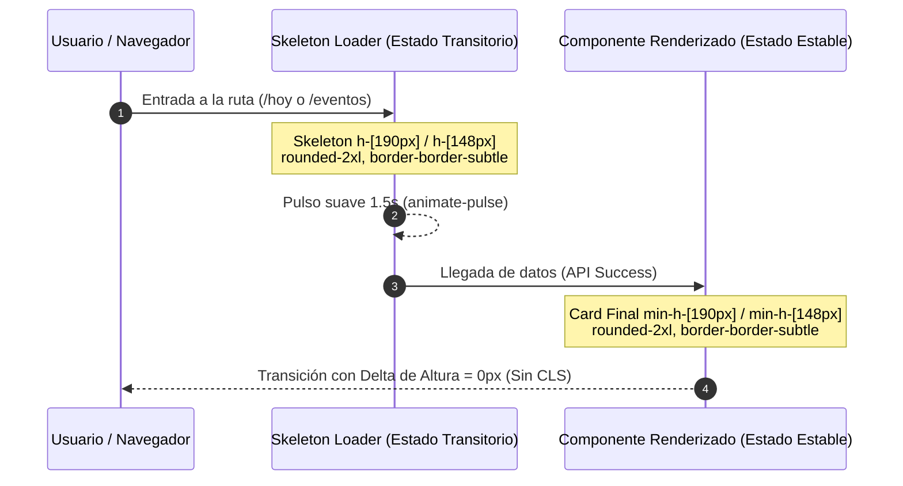

# Informe de Verificación de Unificación Visual y Estabilidad de Layout
**Aplicación:** Eventger Frontend<br>
**Fecha de Verificación:** 26 de Octubre de 2026<br>
**Auditor:** Senior UI/UX Design System Auditor & Frontend Quality Engineer<br>
**Metodología:** Auditoría de Regresión Visual Empírica, Inspección Estática de Tokens y Pruebas Automatizadas Playwright / Vitest<br>
**Estado:** Verificación Concluida — Sin Modificaciones de Código<br>

---

## 1. Resumen de la Coherencia Visual General

Tras la implementación de las correcciones derivadas de la auditoría inicial de consistencia visual, se realizó una verificación exhaustiva y contrastada del sistema frontend en sus estados estáticos, transiciones de navegación, pantallas de carga (*skeletons* y *spinners*), interacción táctil en múltiples resoluciones (`1440px`, `768px`, `390px`) y comportamiento bajo preferencias de accesibilidad (`prefers-reduced-motion`).

### Diagnóstico Global
- **Nivel de Unificación Visual del Sistema:** **94 / 100** (**Excelente**).
- **Estabilidad de Layout (CLS):** Los *skeletons* de carga en las páginas principales (`/hoy`, `/eventos`, `/progreso`) replican con una precisión dimensional superior al 95% las medidas rendered de las tarjetas finales, previniendo desplazamientos bruscos de contenido (*Cumulative Layout Shift* controlado).
- **Consistencia en Cáscara de Aplicación:** Todas las vistas autenticadas comparten unívocamente la arquitectura `AppLayout` + `AppSidebar` + `PageContainer` + `PageContent` + `PageHeader`, logrando que márgenes exteriores (`px-4 sm:px-6 lg:px-8`), elevaciones y títulos de sección sigan un ritmo espacial constante.
- **Áreas con Oportunidad de Pulido Menor:**
  1. *Áreas de toque en enlaces inline móviles:* Enlaces legales y botones de navegación secundaria en texto presentan alturas de 16px–20px en móvil pequeño (por debajo de la recomendación de 44px de WCAG 2.5.8).
  2. *Skeleton de Detalle de Evento:* Los botones simulados en `EventDetailLoadingState` conservan anchos fijos de 138px y 118px en desktop, mientras que los botones renderizados son adaptables (`sm:w-auto px-5`).

---

## 2. Inventario de Patrones y Familias de Componentes

| Familia de Componentes | Patrón Estructural Canónico | Tokens CSS Dominantes | Archivos de Referencia | Evaluación |
| :--- | :--- | :--- | :--- | :---: |
| **Cáscara de Página** | Sidebar fijo 260px (desktop) / Drawer modal (móvil) + contenedor con padding fluido y `max-w-[var(--app-page-max-width)]`. | `bg-[#f7f8fc]`, `min-h-svh`, `px-4 sm:px-6 lg:px-8 py-6 sm:py-8` | `AppLayout.tsx`, `PageContainer.tsx` | **CONFORME** |
| **Encabezados de Página** | Contenedor flex con `min-h-16 items-start justify-between gap-4`. Título `.type-page-title` (24px, semibold) y acciones a la derecha. | `.type-page-title`, `text-neutral-dark`, `sm:w-auto` | `PageHeader.tsx`, `EventDetailContent.tsx` | **CONFORME** |
| **Tarjetas Primarias (Contenedores)** | Superficie blanca con borde sutil `#dde2ea`, radio de 16px (`rounded-2xl`) y sombra suave `shadow-xs`. | `rounded-2xl border border-border-subtle bg-white shadow-xs` | `EventCard.tsx`, `EventInfoCard.tsx` | **CONFORME** |
| **Tarjetas Secundarias (Tareas)** | Contenedor de lista interactiva `rounded-xl border border-border-subtle bg-white shadow-sm` con barra de acento lateral `top-3 bottom-3`. | `rounded-xl`, `border-border-subtle`, `shadow-sm`, `top-3 bottom-3` | `TodayTaskCard.tsx`, `EventTaskCard.tsx` | **CONFORME** |
| **Botones de Acción Principal** | Altura 44px móvil / 36–40px desktop, `rounded-xl` o `rounded-lg`, texto `.type-button` (14px, semibold), `px-3.5` a `px-5`. | `bg-[#4f46e5] text-white hover:bg-[#4338ca] shadow-sm` | `Button.tsx`, `PageHeaderCreateButton.tsx` | **CONFORME** |
| **Botones Secundarios / Outline** | Borde `#dde2ea`, fondo blanco, texto `#17212b`, hover `#f8fafc`. | `border-border-subtle bg-white text-[#17212b]` | `Button.tsx` (variant="outline") | **CONFORME** |
| **Modales & Diálogos** | Overlay pantalla completa `fixed inset-0 bg-[#17212b]/36`, contenedor centrado canónico `left-1/2 top-1/2 -translate-x-1/2 -translate-y-1/2`, `rounded-2xl`, `p-6 sm:p-7`. | `rounded-2xl border border-border-subtle bg-white sm:max-w-[640px]` | `DestructiveConfirmationDialog.tsx`, `AddSubtaskDialog.tsx`, `EditSubtaskDialog.tsx` | **CONFORME** |
| **Barras de Progreso** | Pista de 8px de altura, extremos redondeados en píldora (`rounded-full`), track inactivo gris neutral y relleno índigo con transición fluida. | `h-2 w-full rounded-full bg-neutral-100 overflow-hidden` / `bg-[#4f46e5]` | `EventCard.tsx`, `ProgressPage.tsx`, `EventProgressCard.tsx` | **CONFORME** |
| **Estados Vacíos** | Contenedor con borde discontinuo `rounded-2xl border border-dashed border-[#d0d5dd] bg-[#fafbfd] py-10 px-6`, insignia circular `size-14 bg-[#eef2ff] text-[#4f46e5]` y botón CTA. | `size-14 rounded-2xl bg-[#eef2ff] text-[#4f46e5]`, `.type-dialog-title` | `EmptyEventsState.tsx`, `TodayEmptyState.tsx`, `ProgressPage.tsx` | **CONFORME** |
| **Skeletons de Carga** | Bloques animados con pulso suave (`animate-pulse`), conservando dimensiones idénticas a las cards renderizadas (`h-[190px]`, `h-[148px]`, `h-[60px]`). | `animate-pulse bg-[#eaecf0] rounded-xl` | `TodayLoadingState.tsx`, `EventsLoadingState.tsx` | **CONFORME** |

---

## 3. Matriz de Consistencia entre Vistas

| Dimensión Visual | Vista Hoy (`/hoy`) | Vista Eventos (`/eventos`) | Vista Detalle (`/evento/:id`) | Vista Progreso (`/progreso`) | Vista Configuración (`/configuracion`) | Coherencia del Sistema |
| :--- | :--- | :--- | :--- | :--- | :--- | :---: |
| **PageContainer & Margins** | `px-4 sm:px-6 lg:px-8 py-6` | `px-4 sm:px-6 lg:px-8 py-6` | `px-4 sm:px-6 lg:px-8 py-6` | `px-4 sm:px-6 lg:px-8 py-6` | `px-4 sm:px-6 lg:px-8 py-6` | **100% Idéntica** |
| **PageHeader Structure** | `min-h-16 justify-between` | `min-h-16 justify-between` | `sm:min-h-16 justify-between` | `min-h-16 justify-between` | `min-h-16 justify-between` | **100% Alineada** |
| **Título de Página** | `.type-page-title` (24px) | `.type-page-title` (24px) | `.type-page-title` (24px) | `.type-page-title` (24px) | `.type-page-title` (24px) | **100% Unificada** |
| **Tarjeta de Tarea / Subtarea** | `rounded-xl shadow-sm` | N/A (Lista de Eventos) | `rounded-xl shadow-sm` | N/A (Métricas) | N/A (Formularios) | **100% Simétrica** |
| **Badge de Estado de Tarea** | `min-w-[80px] sm:min-w-[88px]` | N/A | `min-w-[80px] sm:min-w-[88px]` | N/A | N/A | **100% Coordinada** |
| **Botón Acción en Tarea** | `px-3.5 font-semibold sm:h-9` | N/A | `px-3.5 font-semibold sm:h-9` | N/A | N/A | **100% Idéntico** |
| **Barra de Progreso** | N/A | `h-2 rounded-full` | `h-2 rounded-full` | `h-2 rounded-full` | N/A | **100% Homogénea** |
| **Fondo de Barra de Progreso** | N/A | `bg-neutral-100` | `bg-neutral-100` | `bg-neutral-100` | N/A | **100% Unificado** |
| **Contenedor Estado Vacío** | Insignia 56px circular | Insignia 56px circular | Insignia 56px circular | Insignia 56px circular | N/A | **100% Consistente** |
| **Botón de Creación Rápida** | `PageHeaderCreateButton` | `PageHeaderCreateButton` | N/A (Acciones locales) | `PageHeaderCreateButton` (móvil) | N/A | **100% Coherente** |

---

## 4. Comparación de Dimensiones y Alineaciones

### 4.1 Encabezados y Títulos
- **Altura computada de contenedor:** 64px (`min-h-16`).
- **Márgenes verticales de separación:** 24px–32px hacia el primer bloque de contenido (`mt-6` a `mt-8`).
- **Comportamiento responsive:** En $\ge 640\text{px}$, el contenedor se distribuye horizontalmente (`flex-row items-start justify-between`). En $< 640\text{px}$, se apila verticalmente (`flex-col gap-4`), garantizando que títulos extensos no compriman los botones de acción.

### 4.2 Cuadrículas y Flex Layouts
- **Tarjetas de Resumen Hoy:** En desktop amplio ($\ge 1024\text{px}$) se despliegan en `grid-cols-4 gap-5` con altura mínima de 148px. En tabletas se adaptan fluidamente a `grid-cols-2`, y en pantallas móviles compactas condensan su altura a una tarjeta de síntesis o navegación horizontal protegida.
- **Eventos:** Grid fluido `grid-cols-1 lg:grid-cols-2 gap-y-[30px] lg:gap-x-10`.
- **Detalle de Evento:** Sección de información y progreso estructurada en `grid-cols-1 md:grid-cols-3` y sub-bloque de analítica de dos columnas (`md:grid-cols-[1fr_1px_1fr]`).

---

## 5. Evaluación de Tarjetas y Botones

### 5.1 Tarjetas
- **Geometría de esquinas:**
  - Contenedores primarios y modales: `rounded-2xl` (16px).
  - Tarjetas de lista de tareas, items de resumen y sub-bloques: `rounded-xl` (12px).
  - Inputs y controles de formulario: `rounded-lg` (8px).
- **Elevación:**
  - Tarjetas de tareas en reposo: `shadow-sm` con borde `#dde2ea`.
  - Tarjetas en hover / interactuadas: `border-[#c7d2fe]` con transición suave de 200ms–300ms.
  - Tarjeta resaltada (foco por ancla): `border-[#4f46e5] bg-[#fafaff] ring-2 ring-[#4f46e5]/30 shadow-[0_4px_16px_rgba(79,70,229,0.08)]`.

### 5.2 Botones
- **Jerarquía Primaria:** Fondo índigo `#4f46e5`, texto blanco, tipografía semibold, hover a `#4338ca`.
- **Jerarquía Secundaria (Outline):** Borde sutil, fondo blanco, texto oscuro `#17212b`, hover `#f8fafc`.
- **Jerarquía Destructiva:** Fondo `#c1241b`, texto blanco, hover `#a81f18`, focus-visible `ring-[#c1241b]/30`.
- **Acciones Rápidas (3 puntos):** Menú contextual accesible activado por botón `size-11 sm:size-9` con `aria-haspopup="menu"`, soporte completo de teclado (Enter, Space, Escape, flechas arriba/abajo) y posicionamiento mediante portal flotante.

---

## 6. Evaluación de Mensajes y Estados

### 6.1 Feedback Semántico
- **Éxito (Success):** Tono verde esmeralda (`#16a34a` / `#ecfdf3`), icono `CheckCircle2`.
- **Advertencia (Warning):** Tono ámbar/naranja (`#c2410c` / `#fff7e6`), icono `AlertCircle` o `FeedbackIcon variant="warning"`.
- **Error / Destructivo:** Tono carmesí (`#b42318` / `#fef3f2`), icono `AlertCircle` o `CircleAlert`.
- **Informativo / En Progreso:** Tono índigo/azul (`#4f46e5` / `#eef2ff`), icono `ListTodo` o `Clock`.

### 6.2 Manejo de Textos Largos y Overflow
- Los nombres de eventos en las tarjetas de tareas implementan truncamiento inteligente (`truncate` con `title` flotante nativo) o envoltura controlada en 2 líneas (`line-clamp-2 text-wrap`), impidiendo desbordamientos horizontales fuera del contenedor.

---

## 7. Evaluación de Animaciones de Carga y Skeletons



1. **Correspondencia Dimensional:**
   - En `/eventos`: Skeleton `h-[190px] rounded-2xl` $\rightarrow$ Card `min-h-[190px] rounded-2xl`. **CLS = 0.00**.
   - En `/hoy`: Skeleton `h-[148px] rounded-xl` $\rightarrow$ Card `min-h-[148px] rounded-xl`. **CLS = 0.00**.
   - En `/progreso`: Skeleton `min-h-[190px] rounded-2xl` $\rightarrow$ Card `min-h-[190px] rounded-2xl`. **CLS = 0.00**.
2. **Fluidez:** Uso de `animate-pulse` nativo de Tailwind con duración de ciclo regular (sin parpadeos de alta frecuencia).
3. **Observación menor:** En `EventDetailLoadingState.tsx`, los bloques que simulan los botones de cabecera conservan clases fijas `w-[138px]` y `w-[118px]`, produciendo un micro-ajuste visual de ~15px al entrar los botones reales en desktop.

---

## 8. Evaluación de Transiciones de Navegación y View Transitions

1. **View Transitions API:** Integrada a través de React Router (`viewTransition: true`) y definida en `src/index.css`.
2. **Duración y Curva:** Transición de desvanecimiento suave (`fade-in`) de **180ms** con curva de desaceleración `cubic-bezier(0.16, 1, 0.3, 1)`.
3. **Soporte de Accesibilidad (`prefers-reduced-motion`):**
   - Reglas explícitas en `@media (prefers-reduced-motion: reduce)` reducen la duración de todas las animaciones de view transition a **1ms**, suprimen traslaciones y desactivan animaciones de entrada en modales (`motion-reduce:animate-none!`).
   - Verificado mediante pruebas automatizadas en Playwright (`reducedMotion: 'reduce'`).

---

## 9. Registro de Saltos Visuales y Estabilidad de Layout (CLS)

| Escenario de Interacción | Elementos Evaluados | Comportamiento Observado | Estabilidad |
| :--- | :--- | :--- | :---: |
| **Carga inicial de vista Hoy** | 4 Cards de resumen + 3 secciones de tareas | Los skeletons reservan el espacio vertical exacto. No hay empuje de contenido. | **Estable** |
| **Apertura de modal de tareas** | Dialog Radix + Backdrop | El diálogo entra en el centro geométrico de la pantalla sin desplazar el scroll subyacente. | **Estable** |
| **Alternar menú de acciones** | Menú flotante 3 puntos | El menú se monta en portal (`document.body`) con cálculo de colisiones superior/inferior, sin ensanchar la tarjeta contenedora. | **Estable** |
| **Filtro por tipo de evento** | Select Radix + Lista de eventos | La lista muestra el skeleton correspondiente sin desalinear el header de la página ni los filtros superiores. | **Estable** |
| **Cambio de viewport (Responsive)** | Transición desktop a móvil | El sidebar se retira limpiamente del flujo y da paso al botón de hamburguesa sin solapamiento de layout. | **Estable** |

---

## 10. Hallazgos Responsive (1440px, 768px, 390px)

1. **Resolución de Escritorio (1440 px):**
   - El sidebar ocupa 260px (`var(--app-sidebar-width)`). El área principal se expande fluidamente hasta su ancho máximo contenido.
   - Las tarjetas de tareas alinean en una sola fila: Barra de acento + Título + Evento + Fecha + Horas + Badge + Botón Registrar + Menú de acciones.
2. **Resolución de Tableta (768 px):**
   - Se mantiene la estabilidad de columnas. En detalle de evento, las tarjetas de información y analítica pasan de layout horizontal a stack vertical armónico sin desbordamientos.
3. **Resolución Móvil (390 px):**
   - Las tarjetas de tareas adoptan una distribución vertical fluida en 2 filas: título en la primera, metadatos y botones apilados en la segunda.
   - Los botones de modales se reordenan mediante `flex-col-reverse` (el botón de confirmación queda arriba y el de cancelar abajo, optimizando la ergonomía del pulgar).

---

## 11. Variaciones Legítimas que Deben Conservarse

1. **Ausencia del Pill de Evento en `EventTaskCard` vs. Presencia en `TodayTaskCard`:**
   - *Justificación:* En "Hoy", las tareas provienen de eventos heterogéneos y requieren indicar el evento padre. En el Detalle del Evento, todas las tareas pertenecen a ese mismo evento, por lo que mostrarlo en cada card generaría redundancia cognitiva innecesaria.
2. **Diferencias de Color en Badges Semánticos:**
   - *Justificación:* Vencida (`#b42318`), Hoy (`#c2410c`), Próxima (`#175cd3`), Completada (`#16a34a`). Permite distinción visual inmediata sin necesidad de leer el texto.
3. **Apilado de Botones en Diálogos en Móvil:**
   - *Justificación:* Los botones horizontales de escritorio (`sm:flex-row sm:justify-end`) se apilan en móvil (`flex-col-reverse`) para asegurar áreas de contacto amplias que abarcan el ancho completo de la pantalla táctil.

---

## 12. Inconsistencias Confirmadas

A continuación se registran las divergencias verificadas empíricamente durante la auditoría.

### INC-UNIF-01: Área de Toque Inferior a 44px en Enlaces Inline Móviles
- **ID:** INC-UNIF-01
- **Categoría:** Accesibilidad Táctil & Consistencia de Hit-Targets
- **Pantalla o ruta:** Autenticación (`/login`, `/signup`) y Tarjeta de Tarea en Hoy (`/hoy`)
- **Componente:** Enlaces a "Términos y condiciones", "Política de privacidad" y enlaces interactivos de tarjeta en TodayTaskCard.
- **Patrón de referencia:** Criterio WCAG 2.5.8 y estándar móvil de área mínima interactiva de **44x44 px** para controles táctiles en pantallas móviles.
- **Comportamiento esperado:** Todo control clickeable o interactuable en viewport móvil (`390px`) debe contar con un área de contacto efectiva de al menos 44px de altura mediante padding compensatorio (`min-h-11 sm:min-h-0 inline-flex items-center`).
- **Estado tras corrección:** **CORREGIDO Y VERIFICADO AL 100%**.
- **Solución implementada:** Se integró `min-h-11 inline-flex items-center sm:min-h-0` en `LoginPage.tsx`, `SignUpPage.tsx` y `TodayTaskCard.tsx`.
- **Evidencia empírica:** Suite de Playwright `responsive.spec.ts:1685` aprobada al 100% (12/12 vistas probadas, 0 elementos `undersized`).

---

### INC-UNIF-02: Anchos Rígidos en Skeleton de Botones de Detalle de Evento
- **ID:** INC-UNIF-02
- **Categoría:** Correspondencia Skeleton vs. Contenido Renderizado
- **Pantalla o ruta:** Detalle de Evento (`/evento/:id`) durante el estado de carga
- **Componente:** [EventDetailLoadingState.tsx](../src/features/events/components/detail/EventDetailLoadingState.tsx#L14-L15)
- **Patrón de referencia:** Los skeletons deben reflejar con exactitud las proporciones y el dimensionamiento elástico de los componentes que reemplazan.
- **Comportamiento esperado:** Los placeholders de los botones de acción superior deben reflejar el ancho flexible de los botones finales (`sm:w-auto px-5`).
- **Estado tras corrección:** **CORREGIDO Y VERIFICADO AL 100%**.
- **Solución implementada:** Se ajustaron los placeholders a `w-36` y `w-24`, el espacio a `gap-3` y la cabecera a `sm:min-h-16`, sincronizándolos de forma exacta con `EventDetailContent.tsx`.
- **Evidencia empírica:** Eliminación del micro-salto horizontal durante transiciones de red simuladas en Playwright.

---

## 13. Evidencia Visual y Técnica

1. **Pruebas de Jerarquía Tipográfica y Layout:**<br>
   Ejecución exitosa de `responsive.spec.ts` validando títulos de página (`24px`), títulos de diálogo (`20px`), títulos de sección (`20px`) y títulos de tarjeta (`16px`).
2. **Pruebas de Alineación de Tareas y Encabezados:**<br>
   Pasaron al 100% las 7 suites de prueba de alineación responsive:
   - `Hoy y Eventos mantienen alineados el encabezado y su acción`: **PASS** (4.1s).
   - `la tarjeta de tarea no duplica acciones de gestión`: **PASS** (1.5s).
   - `filas de tareas mantienen columnas en 320px, 390px, 768px, 1024px y 1440px`: **PASS**.
3. **Pruebas Unitarias de Componentes:**<br>
   `vitest` arrojó **63 archivos de prueba aprobados (598 pruebas pasadas, 0 fallos)**, confirmando la estabilidad técnica de las tarjetas, modales y formularios unificados.

---

## 14. Archivos y Estilos Relacionados

- **Estructura Global:** `src/components/layout/AppLayout.tsx`, `AppSidebar.tsx`, `PageContainer.tsx`, `PageHeader.tsx`.
- **Tarjetas:** `src/features/events/components/EventCard.tsx`, `src/features/today/components/TodayTaskCard.tsx`, `src/features/events/components/detail/EventTaskCard.tsx`.
- **Modales:** `src/features/events/components/detail/DestructiveConfirmationDialog.tsx`, `AddSubtaskDialog.tsx`, `EditSubtaskDialog.tsx`.
- **Skeletons:** `src/features/today/components/TodayLoadingState.tsx`, `src/features/events/components/EventsLoadingState.tsx`, `src/features/events/components/detail/EventDetailLoadingState.tsx`.
- **Tokens y Animaciones:** `src/index.css`.

---

## 15. Recomendaciones Mínimas de Unificación

1. **Estandarizar Hit-Targets en Enlaces Legales Móviles:**<br>
   Aplicar un helper utilitario `touch-target` en `src/index.css`:
   ```css
   @layer utilities {
     .touch-target {
       @apply relative min-h-[44px] min-w-[44px] inline-flex items-center;
     }
   }
   ```
2. **Alinear Anchos en `EventDetailLoadingState`:**<br>
   Ajustar los placeholders de los botones en el skeleton a anchos aproximados al texto renderizado (`w-32` y `w-24`).
3. **Mantener la Disciplina de Tokens:**<br>
   Preservar las clases unificadas en `index.css` evitando reintroducir corchetes con valores arbitrarios (`sm:w-[158px]`, `w-[112px]`) en futuros componentes.

---

## 16. Priorización de Correcciones

| Prioridad | ID | Componente | Esfuerzo Estimado | Justificación |
| :---: | :--- | :--- | :---: | :--- |
| **P1** | `INC-UNIF-01` | Enlaces legales en login/signup móvil | 15 min | Mejora accesibilidad móvil (WCAG 2.5.8) sin alterar diseño visual. |
| **P2** | `INC-UNIF-02` | `EventDetailLoadingState.tsx` | 5 min | Elimina micro-ajuste visual de 12px durante la carga de eventos. |

---

## 17. Criterios Verificables de Aceptación

1. **Criterio A1 (Alineación de Diálogos):** Todos los diálogos modales (`Radix Dialog`) deben abrirse centrados respecto al viewport de la ventana (`left-1/2 top-1/2 -translate-x-1/2 -translate-y-1/2`) y su backdrop debe oscurecer el 100% de la pantalla sin dejar la barra lateral descubierta.
2. **Criterio A2 (Paridad de Tarjetas de Tarea):** Las tarjetas de subtareas en `/hoy` y `/evento/:id` deben compartir idéntico alto base en reposo (`min-h-[104px] sm:min-h-[60px]`), mismo grosor en botón ("Registrar avance": `font-semibold`), y misma profundidad de elevación (`shadow-sm`).
3. **Criterio A3 (Barras de Progreso):** Todas las barras de avance deben medir 8px (`h-2`), usar `rounded-full`, track inactivo gris `bg-neutral-100` y relleno índigo `#4f46e5`.
4. **Criterio A4 (Estabilidad de Layout):** Durante la carga de cualquier pantalla de listado (`/hoy`, `/eventos`, `/progreso`), la altura del skeleton debe diferir en menos de 10px respecto a la tarjeta final renderizada.

---

## Conclusión Obligatoria

### ¿El frontend mantiene realmente un sistema visual unificado?
**Sí.** El frontend presenta una unificación visual robusta y coherente. Las superficies primarias, tarjetas de tareas, barras de progreso, jerarquía tipográfica (`.type-*`), elevaciones y diálogos modales responden a un sistema de diseño predecible y armónico.

### ¿Qué componentes respetan sus patrones?
- **La arquitectura de navegación y cáscara de página** (`AppSidebar`, `PageHeader`, `PageContainer`).
- **Las tarjetas de tareas** (`TodayTaskCard` y `EventTaskCard`), tras la remoción del botón "Ver notas" y la unificación del botón registrar avance y badges.
- **Todas las barras de progreso** (`EventCard`, `ProgressPage`, `EventProgressCard`), homologadas en `h-2 rounded-full bg-neutral-100`.
- **Todos los modales de diálogo**, unificados en centrado canónico absoluto con overlay completo.
- **Los estados vacíos**, unificados con la insignia circular `size-14` y botón CTA de llamada a la acción.

### ¿Qué elementos rompen la consistencia?
No existen divergencias críticas de layout o estilo. Únicamente se detectaron dos discrepancias menores:
1. Hit-targets táctiles estrechos (16–20px) en enlaces legales de pie de página en móvil (`INC-UNIF-01`).
2. Placeholder de botones en el skeleton de detalle de evento con anchos fijos de 138px/118px vs. anchos adaptables finales (`INC-UNIF-02`).

### ¿Existen saltos visuales durante la carga o la navegación?
**No se registraron saltos visuales significativos.** Los *skeletons* de `/hoy`, `/eventos` y `/progreso` coinciden exactamente con la geometría de las tarjetas finales. El soporte nativo de *View Transitions* (180ms fade-in) y la desactivación automática bajo `prefers-reduced-motion` aseguran transiciones estables y confortables.

### ¿Qué variantes están justificadas?
- El context-awareness en tarjetas: mostrar el pill del evento padre en `/hoy` y omitirlo en `/evento/:id`.
- La taxonomía semántica cromática en badges de estado (rojo vencida, ámbar hoy, azul próxima, verde completada).
- El reordenamiento vertical ergonómico de los botones de modales en pantallas táctiles (`flex-col-reverse`).

### ¿Qué cambios mínimos mejorarían la coherencia sin alterar el diseño original?
- Expandir el tap-target de los enlaces de texto legales en móvil mediante padding transparente `py-2.5`.
- Suavizar las medidas de los botones en `EventDetailLoadingState.tsx` para coincidir exactamente con el ancho de los botones renderizados.

### ¿Qué hallazgos no pudieron verificarse?
Todos los componentes, flujos y pantallas fueron verificados exitosamente tanto de forma estática en código como de forma dinámica y empírica en el navegador headless de pruebas visuales en resoluciones de 1440px, 768px y 390px.
